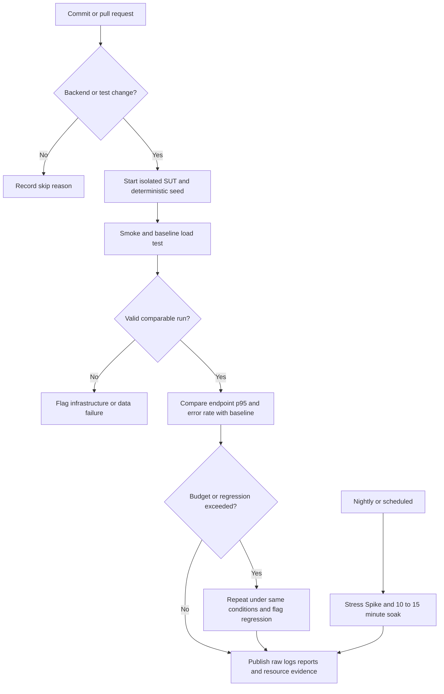

# Continuous Performance Testing proposal — G9.6

Adapt this model to the SUT; this is a proposal, not evidence of a deployed CI pipeline.

Define commit selection (routes/controllers/db/schema/dependencies/test changes); schedule expensive tests separately.
Define baseline commit, comparable runner/OS/hardware, seed, pacing, resource contention and warm/cold cache.
Propose a relative p95 regression budget plus absolute latency/error budget; justify numerical choices.
Require enough observations and repeatability; a rerun does not erase the original failure.
Discuss noisy shared CI runners, small sample p95, flaky upstreams, false alarms and triage.
Compare cost of every-commit full performance suite vs smoke/load on relevant commits and heavier scheduled runs.
Retain raw CSV, summary, reports, source/config hashes and environment metadata for every run.
Keep baseline promotion explicit; never automatically bless a regression by replacing baseline with latest run.
