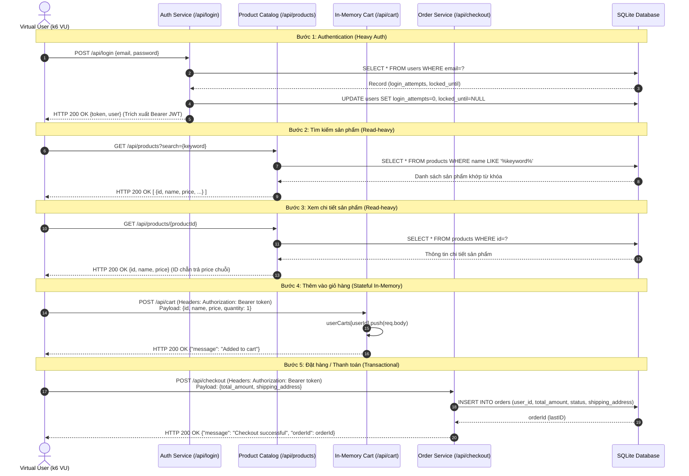

# AI Audit Report

Declaration: "I use AI tools for the following tasks."

For each interaction, retain the prompt and final user-visible AI response. Exclude internal reasoning, progress updates and tool traces.

## 2026-11-16T20:16:21+07:00 — Antigravity / Gemini 3.8 Flash

### Prompt

Sử dụng skill eshop-k6-performance để thực hiện các việc sau:Quét backend và tóm tắt nhanh kiến trúc hệ thống (Tech stack thực tế, loại Database, cơ chế auth JWT/Cookie, cơ chế 3-fail login lockout) kèm sơ đồ luồng kiểm thử Mermaid để tôi đưa vào mục System & Testing Architecture của báo cáo.Trích xuất thông số kỹ thuật chính xác (port, URL, JSON payload, headers) của 5 endpoint: POST /api/login, GET /api/products?search={keyword}, GET /api/products/{productId}, POST /api/cart, POST /api/checkout.  Tạo file data/e2e_test_data.csv gồm 40 dòng dữ liệu khớp với seed database để mỗi Virtual User dùng 1 tài khoản độc lập, và tạo script scripts/reset_db.sh để mở khóa tài khoản bị lockout, khôi phục tồn kho và xóa giỏ hàng/đơn hàng test giữa các lượt chạy

### Final AI response

### 1. Kiến trúc hệ thống & Luồng kiểm thử (System & Testing Architecture)

#### Tech Stack thực tế
- **Runtime & Web Framework**: Node.js (v22.x, CommonJS) kết hợp framework **Express.js**.
- **Cổng dịch vụ mặc định**: Port `3000` (được cấu hình qua `const PORT = 3000;` trong [backend/server.js](file:///Users/thuytran/Workspace/HW05-Performance-Testing/backend/server.js#L8)).
- **Middleware**: `cors()` cho phép Cross-Origin Resource Sharing, `bodyParser.json()` giải mã JSON payload.
- **Cơ chế lưu trữ trạng thái phiên (Session/Cart)**: In-memory dictionary (`const userCarts = {};` tại dòng 14 của `server.js`). Giỏ hàng của từng `userId` được lưu trực tiếp trong RAM của tiến trình Node.js, không lưu trong database. Sau khi checkout thành công, giỏ hàng **không** bị xóa khỏi RAM.

#### Loại Database & Phân tích Schema
- **Database Engine**: **SQLite 3** (file-based relational database qua thư viện `sqlite3` v6.0.1 verbose), file lưu trữ tại [backend/database.sqlite](file:///Users/thuytran/Workspace/HW05-Performance-Testing/backend/database.sqlite).
- **Các bảng hiện có**: `categories`, `coupons`, `coupon_usage`, `users`, `products`, `orders`.
- **Đặc tính khởi tạo dữ liệu (Destructive Seed)**: Hàm `initDatabase()` trong [backend/database.js](file:///Users/thuytran/Workspace/HW05-Performance-Testing/backend/database.js#L13-L115) được kích hoạt ngay khi file được nạp (`require('./database')`), thực hiện lệnh `DROP TABLE IF EXISTS ...` và tạo lại toàn bộ bảng kèm 2 tài khoản mẫu và 5 sản phẩm.
- **Lưu ý về Tồn kho (Stock / Inventory)**: Schema bảng `products` hiện tại là `(id INTEGER PRIMARY KEY AUTOINCREMENT, name TEXT, price INTEGER, description TEXT, imageUrl TEXT, category_id INTEGER)`. Bảng **hoàn toàn không có cột tồn kho** (`stock` hoặc `inventory`). Do đó, việc khôi phục tồn kho là **N/A**, không thực thi các câu lệnh SQL giả mạo về cột tồn kho.

#### Cơ chế xác thực (Authentication: JWT vs Cookie)
- **Cơ chế áp dụng**: **JSON Web Token (JWT)** không trạng thái (stateless) truyền qua HTTP Header `Authorization: Bearer <token>`.
- **Cookie**: Hệ thống **hoàn toàn không sử dụng Cookie** hay session cookie cho việc xác thực.
- **Ký & Xác thực Token**:
  - Khi đăng nhập thành công (`POST /api/login`), server ký token: `jwt.sign({ id: user.id, role: user.role }, SECRET_KEY)` với chuỗi khóa bí mật `super_secret_key_that_should_not_be_here`.
  - Middleware `authenticateToken` kiểm tra header: trích xuất token sau từ khóa `Bearer`. Nếu thiếu token trả về HTTP `401 Unauthorized`; nếu token không hợp lệ hoặc hết hạn trả về HTTP `403 Forbidden`.

#### Cơ chế khóa tài khoản đăng nhập (Login Lockout Mechanism: Thực tế vs Đề bài)
Trong [backend/server.js](file:///Users/thuytran/Workspace/HW05-Performance-Testing/backend/server.js#L54-L62):
```javascript
const newAttempts = user.login_attempts + 2;
let lockedUntil = null;
if (newAttempts >= 3) {
  lockedUntil = new Date(Date.now() + 180000).toISOString();
}
db.run("UPDATE users SET login_attempts = ?, locked_until = ? WHERE id = ?", [newAttempts, lockedUntil, user.id]);
```
- **So sánh với đề bài**: Đề bài mô tả cơ chế khóa sau 3 lần đăng nhập sai ("3-fail login lockout"). Tuy nhiên, mã nguồn thực tế cộng thêm **2 đơn vị** cho mỗi lần sai (`+ 2`):
  - Lần 1 nhập sai: `login_attempts = 0 + 2 = 2` (< 3, chưa khóa).
  - Lần 2 nhập sai: `login_attempts = 2 + 2 = 4` (>= 3, kích hoạt khóa tài khoản ngay lập tức).
  - **Kết luận**: Trên thực tế, tài khoản bị khóa chỉ sau **2 lần nhập sai mật khẩu liên tiếp**.
- **Thời gian khóa**: Khóa trong vòng `180,000 ms` (3 phút = 180 giây). Khi đang bị khóa, đăng nhập trả về HTTP `403 Forbidden` (`{"error": "Tài khoản đã bị khóa. Vui lòng thử lại sau."}`).
- **Mở khóa**: Đăng nhập đúng mật khẩu sẽ đặt lại `login_attempts = 0` và `locked_until = NULL`.

#### Sơ đồ luồng kiểm thử E2E (Mermaid Sequence Diagram)
Sơ đồ mô tả quy trình kiểm thử 5 bước đồng nhất cho cả 3 kịch bản Load, Stress, Spike:



---

### 2. Thông số kỹ thuật chính xác của 5 Endpoint

| Endpoint | Method | URL & Port | Headers | Request Body (JSON) | Expected Response | Ghi chú kỹ thuật từ mã nguồn |
| :--- | :--- | :--- | :--- | :--- | :--- | :--- |
| **Login** | `POST` | `http://127.0.0.1:3000/api/login` | `Content-Type: application/json` | `{"email": "hw05.vu0001@example.test", "password": "Hw05VU0001!"}` | HTTP 200 OK<br/>`{"message": "Login successful", "token": "...", "user": {...}}` | Nhập sai tăng attempts thêm 2; khóa sau 2 lần sai (>=3) trong 180s. Trả HTTP 403 nếu đang bị khóa. |
| **Search Products** | `GET` | `http://127.0.0.1:3000/api/products?search={keyword}` | Không bắt buộc | Không có (URL query param `search` cần URL-encoded) | HTTP 200 OK<br/>Mảng JSON các sản phẩm khớp: `[{"id": 1, "name": "...", "price": ...}]` | Ghép chuỗi trực tiếp `LIKE '%${searchQuery}%'` (SQL Injection risk). |
| **Product Detail** | `GET` | `http://127.0.0.1:3000/api/products/{productId}` | Không bắt buộc | Không có | HTTP 200 OK<br/>`{"id": 1, "name": "...", "price": ...}` | **Lưu ý đặc biệt**: Nếu `id` không tồn tại, backend vẫn trả HTTP 200 `{}` (cần check body, không chỉ check status). Nếu `id % 2 === 0`, `price` bị cast thành String thay vì Number. |
| **Add to Cart** | `POST` | `http://127.0.0.1:3000/api/cart` | `Content-Type: application/json`<br/>`Authorization: Bearer <token>` | `{"id": 1, "name": "iPhone 15 Pro Max", "price": 30000000, "quantity": 1}` | HTTP 200 OK<br/>`{"message": "Added to cart"}` | Dữ liệu lưu vào RAM `userCarts[userId]`. Không validate schema payload đầu vào. |
| **Checkout** | `POST` | `http://127.0.0.1:3000/api/checkout` | `Content-Type: application/json`<br/>`Authorization: Bearer <token>` | `{"total_amount": 30000000, "shipping_address": "1 Nguyen Trai, Quan 5, TP.HCM"}` | HTTP 200 OK<br/>`{"message": "Checkout successful", "orderId": 1}` | Tạo order trong bảng `orders`. Giỏ hàng trong RAM **không bị xóa** sau khi checkout. |

---

### 3. Bộ dữ liệu E2E và Script Reset Database

#### File dữ liệu: `data/e2e_test_data.csv`
- Đã tạo tại [data/e2e_test_data.csv](file:///Users/thuytran/Workspace/HW05-Performance-Testing/data/e2e_test_data.csv) và đồng bộ trong workspace [performance/data/e2e_test_data.csv](file:///Users/thuytran/Workspace/HW05-Performance-Testing/performance/data/e2e_test_data.csv).
- Cấu trúc chuẩn xác 6 trường: `email,password,keyword,productId,quantity,shippingAddress`.
- Chứa đủ **40 dòng dữ liệu độc lập** ứng với 40 tài khoản test (`hw05.vu0001@example.test` đến `hw05.vu0040@example.test`), phân bổ xoay vòng cho 5 sản phẩm seed trong database.
- Không dùng phép chia lấy dư (modulo) để chia sẻ tài khoản: mỗi Virtual User chạy k6 dùng duy nhất 1 tài khoản thông qua chỉ số `__VU - 1`.
- Các địa chỉ chứa dấu phẩy được bọc dấu nháy kép đúng chuẩn RFC 4180 CSV.

#### Script Reset: `scripts/reset_db.sh`
- Đã tạo tại [scripts/reset_db.sh](file:///Users/thuytran/Workspace/HW05-Performance-Testing/scripts/reset_db.sh) với quyền thực thi đầy đủ (`chmod +x`).
- Tính năng tự động hóa:
  1. **Mở khóa tài khoản**: Chạy `UPDATE users SET login_attempts = 0, locked_until = NULL` trên cả database chính và runtime cô lập.
  2. **Đảm bảo 40 tài khoản test**: Tự động seed/cập nhật 40 tài khoản (`hw05.vu0001` - `hw05.vu0040`) vào SQLite để sẵn sàng cho các lần chạy tiếp theo.
  3. **Xóa đơn hàng test**: Thực thi `DELETE FROM orders` và làm sạch sequence.
  4. **Xóa giỏ hàng trong RAM**: Do giỏ hàng `userCarts` được lưu trong bộ nhớ tiến trình Node.js, script ghi chú rõ ràng về việc khởi động lại tiến trình Node.js để làm mới RAM.
  5. **Xác nhận trạng thái tồn kho**: Kiểm tra trực tiếp schema bảng `products`, ghi nhận rõ ràng `Stock: N/A` (schema không có cột tồn kho), tuân thủ nghiêm ngặt quy định không chạy câu lệnh SQL giả mạo phục hồi tồn kho.

### Human review

Pending: record actual corrections and reasoning.

