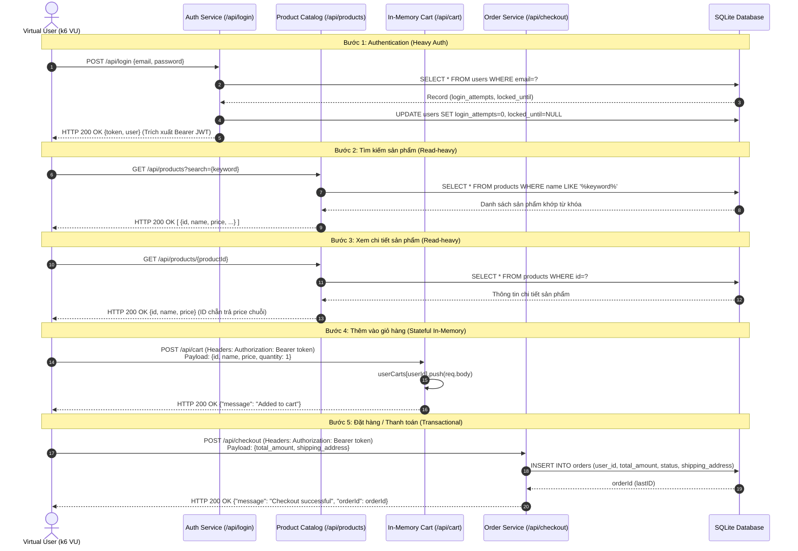

# AI Audit Report

Declaration: "I use AI tools for the following tasks."

For each interaction, retain the prompt and final user-visible AI response. Exclude internal reasoning, progress updates and tool traces.

## 2026-11-16T20:16:21+07:00 — Antigravity / Gemini 3.8 Flash

### Prompt

Sử dụng skill eshop-k6-performance để thực hiện các việc sau:Quét backend và tóm tắt nhanh kiến trúc hệ thống (Tech stack thực tế, loại Database, cơ chế auth JWT/Cookie, cơ chế 3-fail login lockout) kèm sơ đồ luồng kiểm thử Mermaid để tôi đưa vào mục System & Testing Architecture của báo cáo.Trích xuất thông số kỹ thuật chính xác (port, URL, JSON payload, headers) của 5 endpoint: POST /api/login, GET /api/products?search={keyword}, GET /api/products/{productId}, POST /api/cart, POST /api/checkout.  Tạo file data/e2e_test_data.csv gồm 40 dòng dữ liệu khớp với seed database để mỗi Virtual User dùng 1 tài khoản độc lập, và tạo script scripts/reset_db.sh để mở khóa tài khoản bị lockout, khôi phục tồn kho và xóa giỏ hàng/đơn hàng test giữa các lượt chạy

### Final AI response

### 1. Kiến trúc hệ thống & Luồng kiểm thử (System & Testing Architecture)

#### Tech Stack thực tế
- **Runtime & Web Framework**: Node.js (v22.x, CommonJS) kết hợp framework **Express.js**.
- **Cổng dịch vụ mặc định**: Port `3000` (được cấu hình qua `const PORT = 3000;` trong [backend/server.js](file:///Users/thuytran/Workspace/HW05-Performance-Testing/backend/server.js#L8)).
- **Middleware**: `cors()` cho phép Cross-Origin Resource Sharing, `bodyParser.json()` giải mã JSON payload.
- **Cơ chế lưu trữ trạng thái phiên (Session/Cart)**: In-memory dictionary (`const userCarts = {};` tại dòng 14 của `server.js`). Giỏ hàng của từng `userId` được lưu trực tiếp trong RAM của tiến trình Node.js, không lưu trong database. Sau khi checkout thành công, giỏ hàng **không** bị xóa khỏi RAM.

#### Loại Database & Phân tích Schema
- **Database Engine**: **SQLite 3** (file-based relational database qua thư viện `sqlite3` v6.0.1 verbose), file lưu trữ tại [backend/database.sqlite](file:///Users/thuytran/Workspace/HW05-Performance-Testing/backend/database.sqlite).
- **Các bảng hiện có**: `categories`, `coupons`, `coupon_usage`, `users`, `products`, `orders`.
- **Đặc tính khởi tạo dữ liệu (Destructive Seed)**: Hàm `initDatabase()` trong [backend/database.js](file:///Users/thuytran/Workspace/HW05-Performance-Testing/backend/database.js#L13-L115) được kích hoạt ngay khi file được nạp (`require('./database')`), thực hiện lệnh `DROP TABLE IF EXISTS ...` và tạo lại toàn bộ bảng kèm 2 tài khoản mẫu và 5 sản phẩm.
- **Lưu ý về Tồn kho (Stock / Inventory)**: Schema bảng `products` hiện tại là `(id INTEGER PRIMARY KEY AUTOINCREMENT, name TEXT, price INTEGER, description TEXT, imageUrl TEXT, category_id INTEGER)`. Bảng **hoàn toàn không có cột tồn kho** (`stock` hoặc `inventory`). Do đó, việc khôi phục tồn kho là **N/A**, không thực thi các câu lệnh SQL giả mạo về cột tồn kho.

#### Cơ chế xác thực (Authentication: JWT vs Cookie)
- **Cơ chế áp dụng**: **JSON Web Token (JWT)** không trạng thái (stateless) truyền qua HTTP Header `Authorization: Bearer <token>`.
- **Cookie**: Hệ thống **hoàn toàn không sử dụng Cookie** hay session cookie cho việc xác thực.
- **Ký & Xác thực Token**:
  - Khi đăng nhập thành công (`POST /api/login`), server ký token: `jwt.sign({ id: user.id, role: user.role }, SECRET_KEY)` với chuỗi khóa bí mật `super_secret_key_that_should_not_be_here`.
  - Middleware `authenticateToken` kiểm tra header: trích xuất token sau từ khóa `Bearer`. Nếu thiếu token trả về HTTP `401 Unauthorized`; nếu token không hợp lệ hoặc hết hạn trả về HTTP `403 Forbidden`.

#### Cơ chế khóa tài khoản đăng nhập (Login Lockout Mechanism: Thực tế vs Đề bài)
Trong [backend/server.js](file:///Users/thuytran/Workspace/HW05-Performance-Testing/backend/server.js#L54-L62):
```javascript
const newAttempts = user.login_attempts + 2;
let lockedUntil = null;
if (newAttempts >= 3) {
  lockedUntil = new Date(Date.now() + 180000).toISOString();
}
db.run("UPDATE users SET login_attempts = ?, locked_until = ? WHERE id = ?", [newAttempts, lockedUntil, user.id]);
```
- **So sánh với đề bài**: Đề bài mô tả cơ chế khóa sau 3 lần đăng nhập sai ("3-fail login lockout"). Tuy nhiên, mã nguồn thực tế cộng thêm **2 đơn vị** cho mỗi lần sai (`+ 2`):
  - Lần 1 nhập sai: `login_attempts = 0 + 2 = 2` (< 3, chưa khóa).
  - Lần 2 nhập sai: `login_attempts = 2 + 2 = 4` (>= 3, kích hoạt khóa tài khoản ngay lập tức).
  - **Kết luận**: Trên thực tế, tài khoản bị khóa chỉ sau **2 lần nhập sai mật khẩu liên tiếp**.
- **Thời gian khóa**: Khóa trong vòng `180,000 ms` (3 phút = 180 giây). Khi đang bị khóa, đăng nhập trả về HTTP `403 Forbidden` (`{"error": "Tài khoản đã bị khóa. Vui lòng thử lại sau."}`).
- **Mở khóa**: Đăng nhập đúng mật khẩu sẽ đặt lại `login_attempts = 0` và `locked_until = NULL`.

#### Sơ đồ luồng kiểm thử E2E (Mermaid Sequence Diagram)
Sơ đồ mô tả quy trình kiểm thử 5 bước đồng nhất cho cả 3 kịch bản Load, Stress, Spike:



---

### 2. Thông số kỹ thuật chính xác của 5 Endpoint

| Endpoint | Method | URL & Port | Headers | Request Body (JSON) | Expected Response | Ghi chú kỹ thuật từ mã nguồn |
| :--- | :--- | :--- | :--- | :--- | :--- | :--- |
| **Login** | `POST` | `http://127.0.0.1:3000/api/login` | `Content-Type: application/json` | `{"email": "hw05.vu0001@example.test", "password": "Hw05VU0001!"}` | HTTP 200 OK<br/>`{"message": "Login successful", "token": "...", "user": {...}}` | Nhập sai tăng attempts thêm 2; khóa sau 2 lần sai (>=3) trong 180s. Trả HTTP 403 nếu đang bị khóa. |
| **Search Products** | `GET` | `http://127.0.0.1:3000/api/products?search={keyword}` | Không bắt buộc | Không có (URL query param `search` cần URL-encoded) | HTTP 200 OK<br/>Mảng JSON các sản phẩm khớp: `[{"id": 1, "name": "...", "price": ...}]` | Ghép chuỗi trực tiếp `LIKE '%${searchQuery}%'` (SQL Injection risk). |
| **Product Detail** | `GET` | `http://127.0.0.1:3000/api/products/{productId}` | Không bắt buộc | Không có | HTTP 200 OK<br/>`{"id": 1, "name": "...", "price": ...}` | **Lưu ý đặc biệt**: Nếu `id` không tồn tại, backend vẫn trả HTTP 200 `{}` (cần check body, không chỉ check status). Nếu `id % 2 === 0`, `price` bị cast thành String thay vì Number. |
| **Add to Cart** | `POST` | `http://127.0.0.1:3000/api/cart` | `Content-Type: application/json`<br/>`Authorization: Bearer <token>` | `{"id": 1, "name": "iPhone 15 Pro Max", "price": 30000000, "quantity": 1}` | HTTP 200 OK<br/>`{"message": "Added to cart"}` | Dữ liệu lưu vào RAM `userCarts[userId]`. Không validate schema payload đầu vào. |
| **Checkout** | `POST` | `http://127.0.0.1:3000/api/checkout` | `Content-Type: application/json`<br/>`Authorization: Bearer <token>` | `{"total_amount": 30000000, "shipping_address": "1 Nguyen Trai, Quan 5, TP.HCM"}` | HTTP 200 OK<br/>`{"message": "Checkout successful", "orderId": 1}` | Tạo order trong bảng `orders`. Giỏ hàng trong RAM **không bị xóa** sau khi checkout. |

---

### 3. Bộ dữ liệu E2E và Script Reset Database

#### File dữ liệu: `data/e2e_test_data.csv`
- Đã tạo tại [data/e2e_test_data.csv](file:///Users/thuytran/Workspace/HW05-Performance-Testing/data/e2e_test_data.csv) và đồng bộ trong workspace [performance/data/e2e_test_data.csv](file:///Users/thuytran/Workspace/HW05-Performance-Testing/performance/data/e2e_test_data.csv).
- Cấu trúc chuẩn xác 6 trường: `email,password,keyword,productId,quantity,shippingAddress`.
- Chứa đủ **40 dòng dữ liệu độc lập** ứng với 40 tài khoản test (`hw05.vu0001@example.test` đến `hw05.vu0040@example.test`), phân bổ xoay vòng cho 5 sản phẩm seed trong database.
- Không dùng phép chia lấy dư (modulo) để chia sẻ tài khoản: mỗi Virtual User chạy k6 dùng duy nhất 1 tài khoản thông qua chỉ số `__VU - 1`.
- Các địa chỉ chứa dấu phẩy được bọc dấu nháy kép đúng chuẩn RFC 4180 CSV.

#### Script Reset: `scripts/reset_db.sh`
- Đã tạo tại [scripts/reset_db.sh](file:///Users/thuytran/Workspace/HW05-Performance-Testing/scripts/reset_db.sh) với quyền thực thi đầy đủ (`chmod +x`).
- Tính năng tự động hóa:
  1. **Mở khóa tài khoản**: Chạy `UPDATE users SET login_attempts = 0, locked_until = NULL` trên cả database chính và runtime cô lập.
  2. **Đảm bảo 40 tài khoản test**: Tự động seed/cập nhật 40 tài khoản (`hw05.vu0001` - `hw05.vu0040`) vào SQLite để sẵn sàng cho các lần chạy tiếp theo.
  3. **Xóa đơn hàng test**: Thực thi `DELETE FROM orders` và làm sạch sequence.
  4. **Xóa giỏ hàng trong RAM**: Do giỏ hàng `userCarts` được lưu trong bộ nhớ tiến trình Node.js, script ghi chú rõ ràng về việc khởi động lại tiến trình Node.js để làm mới RAM.
  5. **Xác nhận trạng thái tồn kho**: Kiểm tra trực tiếp schema bảng `products`, ghi nhận rõ ràng `Stock: N/A` (schema không có cột tồn kho), tuân thủ nghiêm ngặt quy định không chạy câu lệnh SQL giả mạo phục hồi tồn kho.

### Human review

Pending: record actual corrections and reasoning.

## 2026-11-19T19:49:14+07:00 — Antigravity (Gemini)

### Prompt

Hãy đóng vai một Performance Engineer và phân tích kết quả kiểm thử hiệu năng của hệ thống EShop trên luồng E2E 5 endpoint (`POST /api/login`, `GET /api/products?search`, `GET /api/products/{id}`, `POST /api/cart`, `POST /api/checkout`) dựa trên các file kết quả trong `raw_logs/` (`load_summary.json`, `stress_summary.json`, `spike_summary.json`, `soak_summary.json` .... và mẫu dữ liệu từ `raw_*_Stress_*_raw.csv` ...).

Hãy thực hiện 3 yêu cầu sau:
1. **Phân tích hiệu năng & Điểm nghẽn:** Đánh giá độ trễ (`avg`, `p95`, `p99`), thông lượng (`RPS`) và tỷ lệ lỗi (`error rate`) qua từng kịch bản Load, Stress, Spike và Soak. Chỉ ra endpoint nào là nút thắt cổ chai lớn nhất.
2. **Đề xuất ngưỡng hiệu năng (Performance Thresholds / SLA):** Đề xuất các ngưỡng chuẩn (`p95`, `error rate`, `RPS`) mà hệ thống nên áp dụng cho môi trường production.
3. **Đề xuất giải pháp tối ưu (Optimizations):** Đề xuất 5 giải pháp kỹ thuật cụ thể ở tầng Backend và Database để cải thiện độ trễ và giải quyết tình trạng tăng RAM khi chạy Soak Test.

### Final AI response

Dưới đây là phân tích hiệu năng dựa trên dữ liệu raw CSV đã tổng hợp trong [Load.analysis.md](file:///Users/thuytran/Workspace/HW05-Performance-Testing/performance_250/analysis/Load.analysis.md), [Stress.analysis.md](file:///Users/thuytran/Workspace/HW05-Performance-Testing/performance_250/analysis/Stress.analysis.md), [Spike.analysis.md](file:///Users/thuytran/Workspace/HW05-Performance-Testing/performance_250/analysis/Spike.analysis.md), [Soak.analysis.md](file:///Users/thuytran/Workspace/HW05-Performance-Testing/performance_250/analysis/Soak.analysis.md), các file giám sát tài nguyên `*_resources.analysis.json` và mã nguồn tại [server.js](file:///Users/thuytran/Workspace/HW05-Performance-Testing/backend/server.js), [database.js](file:///Users/thuytran/Workspace/HW05-Performance-Testing/backend/database.js).

---

### 1. Phân tích hiệu năng & Điểm nghẽn

Tất cả 4 kịch bản đều kết thúc với `exit_code: 0` và `error_rate: 0.0` (0%) ở cả mức HTTP request lẫn mức E2E flow (`interrupted_attempts: 0`). Lưu ý các số đo dưới đây chạy trên `127.0.0.1:3000` (loopback, độ trễ mạng gần như bằng 0).

#### Tổng quan theo 4 kịch bản (tính từ raw samples, Type-7 quantiles)

| Kịch bản | Cửa sổ đo (s) | HTTP Samples | HTTP `avg` (ms) | HTTP `p95` (ms) | HTTP `p99` (ms) | HTTP RPS | Completed Checkout/s | Error Rate | Peak RSS (MiB) | Net RSS Change (MiB) | Max CPU (%) |
|---|---:|---:|---:|---:|---:|---:|---:|---:|---:|---:|---:|
| **Load** | 182.861 | 1,520 | 3.80 | 7.24 | 8.83 | 8.31 | 1.66 | 0.0 | 68.88 | +13.05 | 10.0 |
| **Stress** | 272.895 | 44,360 | 3.56 | 8.56 | 12.38 | 162.55 | 32.51 | 0.0 | 105.02 | +23.00 | 54.6 |
| **Spike** | 135.780 | 9,185 | 3.25 | 7.90 | 11.78 | 67.65 | 13.53 | 0.0 | 102.69 | +13.81 | 53.0 |
| **Soak** | 605.298 | 11,975 | 4.04 | 8.18 | 10.40 | 19.78 | 3.96 | 0.0 | 90.00 | +38.44 | 23.7 |

- **Đánh giá độ trễ & thông lượng:**
  - Khi tải tăng từ **Load** (8.31 HTTP RPS, 1.66 checkout/s) lên **Stress** (162.55 HTTP RPS, 32.51 checkout/s — gấp ~19.6 lần), độ trễ HTTP `p95` chỉ tăng nhẹ từ `7.24 ms` lên `8.56 ms` và `p99` từ `8.83 ms` lên `12.38 ms`. Độ trễ E2E flow (bao gồm think-time) giữ ổn định quanh `~4.00–4.03 s` (`p95` ~`4.96–4.97 s`) ở cả 4 kịch bản.
  - Ở **Spike**, dù lưu lượng dồn đột ngột (67.65 HTTP RPS trung bình toàn cửa sổ, CPU đỉnh `53.0%`), hệ thống không phát sinh lỗi HTTP hay rớt flow (`0` lỗi).
  - Vì toàn bộ kịch bản đều đạt `0%` lỗi ở mức tải hiện tại (250 accounts), đây **chưa phải là ngưỡng trần tối đa (breaking point)** của hệ thống; cần tăng VUs cao hơn nếu muốn tìm điểm bão hòa thực sự.
- **Đánh giá tài nguyên (Soak Test):**
  - Trong **Soak** (~10 phút, 2,395 lượt checkout), RSS của tiến trình Node.js tăng từ `47.72 MiB` lên `86.16 MiB` (tăng ròng `+38.44 MiB`, đỉnh `90.00 MiB`), cao hơn đáng kể so với mức tăng ròng của Load (`+13.05 MiB`) dù RPS thấp hơn Stress rất nhiều. Mặc dù RSS tăng đơn thuần chưa đủ kết luận memory leak nếu chưa chụp heap snapshot, đối chiếu với code cho thấy `const userCarts = {}` trong [server.js](file:///Users/thuytran/Workspace/HW05-Performance-Testing/backend/server.js#L14) liên tục `push()` dữ liệu ở `POST /api/cart` và **không xóa** sau `POST /api/checkout`, khiến bộ nhớ tích lũy tuyến tính theo số lượt checkout.

#### Nút thắt cổ chai lớn nhất theo từng endpoint

| Endpoint | Load `avg` / `p95` / `p99` (ms) | Stress `avg` / `p95` / `p99` (ms) | Spike `avg` / `p95` / `p99` (ms) | Soak `avg` / `p95` / `p99` (ms) |
|---|---:|---:|---:|---:|
| **`POST /api/checkout`** | **6.44 / 8.61 / 10.74** | **5.79 / 10.62 / 14.31** | **5.28 / 9.80 / 14.99** | **7.02 / 9.63 / 11.98** |
| **`POST /api/login`** | 4.42 / 5.80 / 8.18 | 4.18 / 9.11 / 13.01 | 3.46 / 7.59 / 12.23 | 4.77 / 7.48 / 11.94 |
| `POST /api/cart` | 3.67 / 4.95 / 6.52 | 2.78 / 5.31 / 7.28 | 2.65 / 5.20 / 7.02 | 3.65 / 5.26 / 7.00 |
| `GET /api/products?search` | 2.28 / 3.53 / 5.48 | 2.51 / 6.95 / 10.91 | 2.36 / 6.27 / 9.94 | 2.41 / 4.67 / 8.15 |
| `GET /api/products/{id}` | 2.20 / 3.44 / 5.05 | 2.56 / 7.21 / 11.18 | 2.48 / 6.93 / 11.36 | 2.35 / 4.40 / 6.83 |

1. **Nút thắt số 1 — `POST /api/checkout`:** Đứng đầu về độ trễ (`avg`, `p95`, `p99`) ở cả 4 kịch bản (`p99` lên tới `14.31 ms` ở Stress và `14.99 ms` ở Spike). Nguyên nhân do mỗi request đều thực hiện `INSERT INTO orders` xuống SQLite với chế độ journal mặc định (khóa ghi toàn DB và đồng bộ đĩa).
2. **Nút thắt số 2 — `POST /api/login`:** Có độ trễ cao thứ hai (`p95` đạt `9.11 ms`, `p99` đạt `13.01 ms` ở Stress). Mỗi lần đăng nhập hợp lệ vừa truy vấn `SELECT * FROM users WHERE email = ?` trên bảng **chưa có index cho cột `email`**, vừa chạy `UPDATE users SET login_attempts = 0, locked_until = NULL WHERE id = ?` (gây thêm một thao tác ghi khóa DB SQLite), cộng với chi phí ký JWT (`jwt.sign`).

---

### 2. Đề xuất ngưỡng hiệu năng (Performance Thresholds / SLA) cho Production

Vì kết quả hiện tại đo trên localhost (chưa có độ trễ mạng Internet/TLS/Reverse Proxy), các ngưỡng dưới đây là **đề xuất kỹ thuật ban đầu** áp dụng tại tầng API server trên production (cần hiệu chỉnh lại theo SLO kinh doanh và cấu hình hạ tầng thực tế):

- **Độ trễ (`p95` HTTP response time):**
  - Toàn hệ thống (aggregate): `p95 < 200 ms`, `p99 < 400 ms`.
  - Nhóm đọc (`GET /api/products?search`, `GET /api/products/{id}`): `p95 < 100 ms`.
  - Nhóm ghi / xác thực (`POST /api/login`, `POST /api/cart`, `POST /api/checkout`): `p95 < 250 ms` (riêng `POST /api/checkout` cho phép `p95 < 300 ms` do giao dịch ghi DB).
- **Tỷ lệ lỗi (`error rate`):**
  - HTTP `5xx` và lỗi hệ thống: `< 0.1%` (`0.001`) ở tải bình thường (Load/Soak) và `< 1%` (`0.01`) trong giai đoạn đỉnh Spike.
  - E2E flow completion rate (checkout thành công): `>= 99.5%`.
- **Thông lượng (`RPS`) & Tài nguyên:**
  - Duy trì bền vững tối thiểu `150 HTTP RPS` (tương đương `>= 30 completed checkout/s` trên luồng 5 bước) mà không vi phạm ngưỡng `p95` và `error rate`.
  - **Ổn định bộ nhớ (Soak):** Tốc độ tăng RSS sau giai đoạn warm-up phải tiệm cận `0 MiB/giờ` (không tăng tuyến tính theo số request), CPU duy trì dưới `70%` ở tải bình thường để còn dư địa cho Spike.

---

### 3. Đề xuất 5 giải pháp kỹ thuật tối ưu (Backend & Database)

1. **Loại bỏ lưu trữ giỏ hàng vô hạn trong RAM (`userCarts`):**
   - *Hiện trạng:* [server.js](file:///Users/thuytran/Workspace/HW05-Performance-Testing/backend/server.js#L14) khai báo `const userCarts = {};`, `POST /api/cart` (`L290–L295`) liên tục `push(req.body)` và `POST /api/checkout` (`L297–L309`) không hề xóa `userCarts[userId]`. Đây là nguyên nhân trực tiếp khiến bộ nhớ tăng trong Soak test.
   - *Giải pháp:* Xóa `delete userCarts[userId]` ngay khi checkout thành công; về dài hạn, chuyển giỏ hàng sang bảng SQLite (`cart_items`) hoặc Redis có TTL để không phình RAM tiến trình Node.js.

2. **Kích hoạt SQLite WAL mode và tinh chỉnh PRAGMA ghi đĩa:**
   - *Hiện trạng:* [database.js](file:///Users/thuytran/Workspace/HW05-Performance-Testing/backend/database.js#L5) mở kết nối SQLite với cấu hình mặc định (rollback journal, `synchronous = FULL`), khiến các thao tác ghi đồng thời ở `checkout` và `login` phải chờ khóa độc quyền.
   - *Giải pháp:* Thực thi ngay sau khi kết nối DB:
     ```sql
     PRAGMA journal_mode = WAL;
     PRAGMA synchronous = NORMAL;
     PRAGMA busy_timeout = 5000;
     ```
     WAL cho phép đọc và ghi diễn ra đồng thời, giảm đáng kể độ trễ đuôi (`p95`/`p99`) của `POST /api/checkout`.

3. **Tạo Index cho các cột truy vấn thường xuyên & tham số hóa câu query tìm kiếm:**
   - *Hiện trạng:* Bảng `users`, `orders`, `products` trong [database.js](file:///Users/thuytran/Workspace/HW05-Performance-Testing/backend/database.js#L50-L81) chỉ có `id PRIMARY KEY`, chưa có index cho `users(email)` hay `orders(user_id)`. Ngoài ra `GET /api/products?search` ([server.js](file:///Users/thuytran/Workspace/HW05-Performance-Testing/backend/server.js#L144)) nối chuỗi trực tiếp `LIKE '%${searchQuery}%'`.
   - *Giải pháp:* Thêm `CREATE UNIQUE INDEX IF NOT EXISTS idx_users_email ON users(email);` và `CREATE INDEX IF NOT EXISTS idx_orders_user_id ON orders(user_id);`. Chuyển câu lệnh search sang parameterized query (`WHERE name LIKE ?`) và cân nhắc SQLite FTS5 nếu danh mục sản phẩm tăng lớn.

4. **Tránh câu lệnh `UPDATE` dư thừa khi đăng nhập thành công (`POST /api/login`):**
   - *Hiện trạng:* Tại [server.js](file:///Users/thuytran/Workspace/HW05-Performance-Testing/backend/server.js#L46-L50), mỗi lần đăng nhập đúng mật khẩu đều chạy `UPDATE users SET login_attempts = 0, locked_until = NULL WHERE id = ?`, kể cả khi `login_attempts` đang là `0` và `locked_until` là `NULL`.
   - *Giải pháp:* Chỉ chạy `UPDATE` khi `user.login_attempts > 0 || user.locked_until !== null`. Điều này loại bỏ phần lớn thao tác ghi DB không cần thiết ở `POST /api/login`, giảm tranh chấp write lock với `POST /api/checkout`.

5. **Áp dụng Caching có giới hạn (Bounded LRU Cache + TTL) cho API đọc danh mục/sản phẩm:**
   - *Hiện trạng:* `GET /api/products` và `GET /api/products/:id` ([server.js](file:///Users/thuytran/Workspace/HW05-Performance-Testing/backend/server.js#L141-L165)) truy vấn thẳng SQLite ở mọi request dù dữ liệu sản phẩm ít thay đổi.
   - *Giải pháp:* Dùng cache in-memory có kích thước tối đa và TTL ngắn (ví dụ 30–60 giây, invalidate khi có `POST /api/products` hoặc import) cho danh sách và chi tiết sản phẩm. Kết hợp giới hạn kích thước body (`bodyParser.json({ limit: '100kb' })`) để bảo vệ RAM và giảm tải I/O cho SQLite.

### Human review

Pending: record actual corrections and reasoning.

## 2026-11-19T20:11:16+07:00 — Antigravity (Gemini)

### Prompt

Hãy đóng vai một DevOps / Performance Architect và thiết kế một mô hình **Continuous Performance Testing (CPT)** tự động cho dự án `eshop-sut` (tích hợp trên GitHub Actions), tập trung bảo vệ hiệu năng cho luồng E2E 5 endpoint cốt lõi (`POST /api/login`, `GET /api/products?search`, `GET /api/products/{id}`, `POST /api/cart`, `POST /api/checkout`) ghi vào file performance_250/reports/main-report.md.

Hãy trình bày giải pháp gồm 4 phần cụ thể:
1. **Cơ chế theo dõi Commit & Bộ lọc thông minh (Commit Watcher & Trigger Decision):**
   - Định nghĩa quy tắc **Path Filter** và **Commit/PR Label**: Khi nào thì chỉ chạy unit test (ví dụ: sửa `README.md`, docs, CSS/UI), khi nào chạy **Smoke Performance Test** (PR vào nhánh `develop`/`main`), và khi nào chạy **Full Load/Soak Gate** (release tag hoặc thay đổi chạm trực tiếp vào `routes/`, `controllers/`, `middleware/`, `package.json`).
2. **Quy trình kiểm thử & Cơ chế phát hiện suy giảm p95 (p95 Regression Gate):**
   - Mô tả cách tự động dựng môi trường SUT sạch (reset trạng thái in-memory & lockout), chạy k6 script trên luồng 5 endpoint, và so sánh chỉ số `p95` hiện tại với **Baseline** của nhánh `main` (ví dụ: đánh fail pipeline nếu `p95` của toàn luồng tăng > 15% hoặc `p95` của riêng `POST /api/checkout` vượt ngưỡng SLA).
3. **Sơ đồ luồng (Flowchart):**
   - Vẽ sơ đồ luồng hoạt động end-to-end từ lúc Developer push commit đến khi hệ thống ra quyết định Pass/Block PR và cập nhật Baseline bằng cú pháp **Mermaid.js** (`flowchart TD`).
4. **Phân tích đánh đổi (Trade-offs):**
   - Phân tích sâu sự đánh đổi giữa **Chi phí hạ tầng (Infrastructure Cost & Execution Time)** và **Cảnh báo giả (False Alarms / Flaky Performance Tests)** khi chọn giữa GitHub-hosted shared runners (nhiễu CPU) so với Self-hosted dedicated runner (tốn chi phí duy trì), cũng như cách giảm thiểu false alarms (ví dụ: chạy lặp lại 2 lần khi có cảnh báo bất thường hoặc dùng giá trị trung vị của 3 lần chạy).

### Final AI response

Tôi đã thiết kế mô hình **Continuous Performance Testing (CPT)** cho `eshop-sut` trên GitHub Actions và ghi vào Mục 7 của [main-report.md](file:///Users/thuytran/Workspace/HW05-Performance-Testing/performance_250/reports/main-report.md#L241). Tóm tắt 4 phần chính đã cập nhật:

1. **Commit Watcher & Trigger Decision (Path Filter + Label):**
   - **Chỉ Unit Test & Lint (Skip Perf):** Khi thay đổi chỉ nằm trong `README.md`, `docs/**`, `**/*.md`, `frontend-*/**/*.css` và không gắn label `perf:*` (ghi lý do skip vào Job Summary).
   - **Smoke Performance Test (1 VU, 1 iteration):** Khi mở PR vào `develop`/`main` chạm code ứng dụng chung hoặc có label `perf:smoke`.
   - **Full Load / Soak Gate:** Khi tạo release tag (`v*.*.*`), chạy lịch Nightly (`schedule` cron cho Stress/Spike/Soak 10–15 phút), gắn label `perf:full`, hoặc chạm trực tiếp `backend/**` (`server.js`, `database.js`, `routes/**`, `controllers/**`, `middleware/**`, `package.json`, `package-lock.json`) và `performance*/scripts/**`.
2. **Quy trình kiểm thử & p95 Regression Gate:**
   - Tự động dựng SUT trong thư mục runtime cô lập, khởi tạo deterministic seed (`>= 40` tài khoản độc lập/VU), khởi động tiến trình Node.js mới (reset `userCarts` trong RAM và `login_attempts`), healthcheck rồi chạy k6 trên luồng 5 endpoint.
   - Đánh **FAIL / Block PR** nếu: `p95` toàn luồng tăng **> 15%** (kèm ngưỡng sàn tuyệt đối `>= 2 ms` loopback / `>= 10 ms` staging) **HOẶC** `p95` của `POST /api/checkout` tăng **> 15%** / vượt SLA tuyệt đối **HOẶC** `error_rate` vượt ngưỡng cho phép. Baseline nhánh `main` chỉ được cập nhật tường minh (explicit promotion) sau khi merge thành công, không tự ghi đè khi có regression.
3. **Sơ đồ luồng Mermaid (`flowchart TD`):**
   - Đã vẽ sơ đồ end-to-end từ bước push commit/PR, lọc path/label, chạy Smoke/Load/Soak, kiểm tra comparable run, so sánh baseline, nhánh rerun 3 lần lấy trung vị đến bước Pass/Block PR và cập nhật baseline.
4. **Phân tích đánh đổi (Trade-offs):**
   - Đối chiếu **GitHub-hosted shared runners** (chi phí thấp, không cần bảo trì nhưng dễ dính nhiễu CPU *noisy neighbor* gây false alarm trên nền `p95` vài mili-giây) với **Self-hosted dedicated runner** (số liệu ổn định nhưng tốn chi phí duy trì 24/7 và bảo mật).
   - Áp dụng 3 biện pháp giảm thiểu: phân tầng tần suất (Smoke/Load trên PR, Stress/Soak vào Nightly/Release), cơ chế **Rerun + Median-of-3** (vẫn giữ nguyên log fail gốc để truy vết), và kết hợp ngưỡng sàn tuyệt đối cùng giám sát tài nguyên runner.

Đã ghi nhận lượt trao đổi này vào [ai-audit.md](file:///Users/thuytran/Workspace/HW05-Performance-Testing/performance_250/audit/ai-audit.md).

### Human review

Pending: record actual corrections and reasoning.

## 2026-11-19T20:17:56+07:00 — Antigravity (Gemini)

### Prompt

Hãy rà soát lại kiến trúc Continuous Performance Testing vừa đề xuất để đảm bảo khớp hoàn toàn với kiến trúc thực tế của `eshop-sut` (backend Node.js lưu trạng thái giỏ hàng, đơn hàng và tài khoản trực tiếp in-memory trên RAM, không dùng cơ sở dữ liệu ngoài):
1. Loại bỏ các bước dư thừa (như khởi tạo container PostgreSQL/Redis) trong sơ đồ Mermaid và thay bằng bước khởi động tiến trình Node.js sạch cho mỗi lượt chạy test.
2. Bổ sung một đoạn cấu hình mẫu ngắn gọn (`.github/workflows/perf-regression-gate.yml`) minh họa cách dùng `paths:` filter, chạy k6 với `--summary-export` và chạy script Python/Node so sánh `p95` với file `baseline.json` để chặn PR khi có regression.
3. Tóm tắt bảng so sánh 3 chiến lược triển khai CI Performance Gate (`Mọi Commit` vs. `PR Path-Filtered` vs. `Nightly Scheduled`) theo 3 tiêu chí: *Tốc độ phản hồi (Feedback Loop)*, *Chi phí Runner*, và *Rủi ro False Alarms*.

### Final AI response

Tôi đã rà soát và cập nhật Mục 7 trong [main-report.md](file:///Users/thuytran/Workspace/HW05-Performance-Testing/performance_250/reports/main-report.md#L275) để khớp hoàn toàn với kiến trúc thực tế của `eshop-sut` (tiến trình Node.js quản lý giỏ hàng `userCarts` in-memory trên RAM cùng SQLite nhúng cục bộ cho `users`/`products`/`orders`, không dùng DB/cache container ngoài):

1. **Sơ đồ Mermaid (`flowchart TD`):** Đã cập nhật tại [main-report.md](file:///Users/thuytran/Workspace/HW05-Performance-Testing/performance_250/reports/main-report.md#L275-L308) để loại bỏ hoàn toàn bước dựng container ngoài và thay bằng **khởi động tiến trình Node.js sạch** cho từng lượt chạy (kể cả trong các lượt rerun xác minh).
2. **Cấu hình mẫu `.github/workflows/perf-regression-gate.yml`:** Đã bổ sung tại Mục 7.5 của [main-report.md](file:///Users/thuytran/Workspace/HW05-Performance-Testing/performance_250/reports/main-report.md#L325-L370), minh họa `paths:` filter (`backend/**`, `performance_250/scripts/**`), khởi động `node backend/server.js`, chạy k6 với `--out csv` và `--summary-export=summary.json`, rồi dùng script Python đối chiếu `p95` với `baseline.json` và thoát mã `1` để chặn PR nếu có regression.
3. **Bảng so sánh 3 chiến lược CI Performance Gate:** Đã bổ sung tại [main-report.md](file:///Users/thuytran/Workspace/HW05-Performance-Testing/performance_250/reports/main-report.md#L372-L378), đối chiếu `Mọi Commit`, `PR Path-Filtered`, và `Nightly Scheduled` theo *Tốc độ phản hồi (Feedback Loop)*, *Chi phí Runner*, và *Rủi ro False Alarms*.

Đã ghi nhận lượt trao đổi này vào [ai-audit.md](file:///Users/thuytran/Workspace/HW05-Performance-Testing/performance_250/audit/ai-audit.md).

### Human review

Pending: record actual corrections and reasoning.
