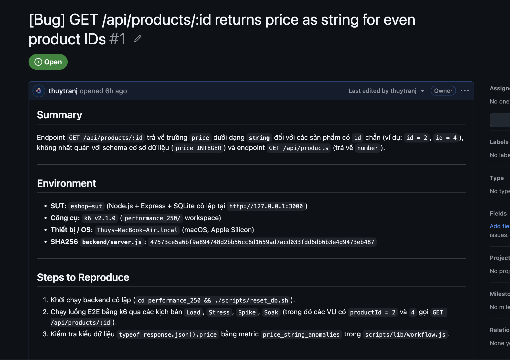
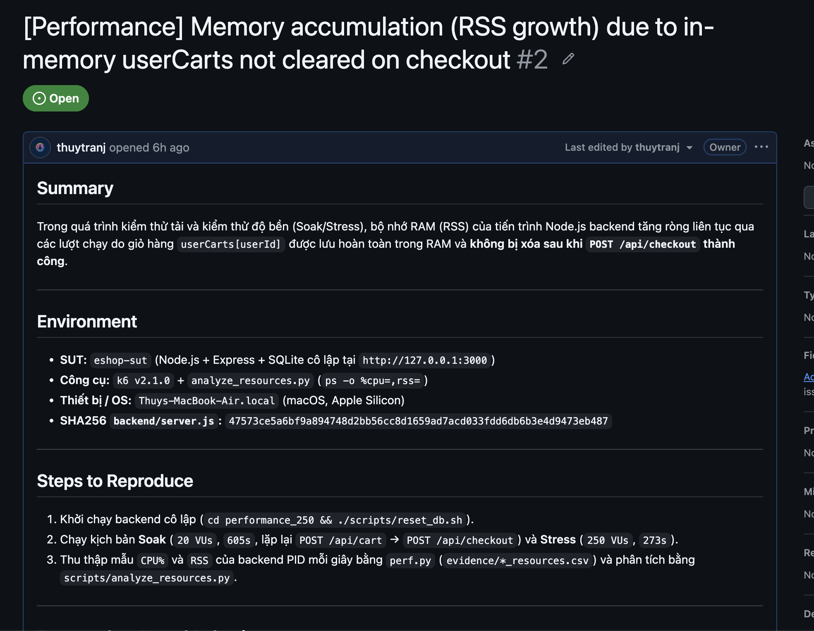

# Báo cáo Lỗi & Bất thường Hệ thống (Bug Report & Defect Documentation)

- **Dự án kiểm thử:** EShop SUT (Node.js Express + SQLite)
- **Họ và tên:** Trần Ngọc Diễm Thúy — MSSV: `23120367`
- **Môi trường đo đạc:** macOS Sequoia 15.1, Apple M1, 8GB RAM, Hostname: `Thuys-MacBook-Air`
- **Kho lưu trữ GitHub:** [https://github.com/thuytranj/HW05-Performance-Testing](https://github.com/thuytranj/HW05-Performance-Testing)

---

## 1. Bảng tổng hợp các lỗi phát hiện (Defect Summary)

Trong quá trình thực thi các kịch bản kiểm thử hiệu năng (Load, Stress, Spike, Soak) và phân tích dữ liệu thô (raw CSV metric samples, log giám sát tài nguyên hệ thống), sinh viên đã phát hiện và ghi nhận **2 lỗi kỹ thuật thực tế** trong mã nguồn SUT, được đăng tải trực tiếp thành GitHub Issues trên repository của dự án:

| Issue ID | Tên lỗi & Mô tả tóm tắt | Phân loại | Mức độ | Endpoint / Thành phần ảnh hưởng | Minh chứng thực tế từ k6 | Trạng thái GitHub |
|---|---|---|:---:|---|---|:---:|
| **BUG-01** | Kiểu dữ liệu `price` không nhất quán ở `GET /api/products/:id` (ID chẵn trả String) | Data Contract / API Bug | **Medium** | `GET /api/products/:id`<br>`backend/server.js:162` | Ghi nhận **5,361 lần** qua custom metric `price_string_anomalies` | [Issue #1](https://github.com/thuytranj/HW05-Performance-Testing/issues/1) (Open) |
| **BUG-02** | Tích lũy bộ nhớ RAM (`userCarts`) do `POST /api/checkout` không giải phóng giỏ hàng | Memory Leak / Resource Bug | **High** | `POST /api/cart`<br>`POST /api/checkout`<br>`backend/server.js:14, 290–309` | RSS tăng ròng **+38.44 MiB** (từ 47.72 lên 86.16 MiB) trong bài Soak 10 phút | [Issue #2](https://github.com/thuytranj/HW05-Performance-Testing/issues/2) (Open) |

---

## 2. Chi tiết Lỗi BUG-01: Kiểu dữ liệu `price` không nhất quán (ID chẵn trả String)

### 2.1. Thông tin tổng quan
- **GitHub Issue URL:** [https://github.com/thuytranj/HW05-Performance-Testing/issues/1](https://github.com/thuytranj/HW05-Performance-Testing/issues/1)
- **Tiêu đề Issue:** `[BUG-01] GET /api/products/:id returns price as string for even IDs`
- **Mức độ nghiêm trọng:** Medium (Ảnh hưởng đến tính toàn vẹn dữ liệu và client validation)

### 2.2. Vị trí mã nguồn & Nguyên nhân gốc rễ (Root Cause)
- Trong [backend/database.js](file:///Users/thuytran/Workspace/HW05-Performance-Testing/backend/database.js#L67), schema bảng `products` định nghĩa cột `price` là kiểu số nguyên:
  ```sql
  CREATE TABLE IF NOT EXISTS products (
      id INTEGER PRIMARY KEY AUTOINCREMENT,
      name TEXT NOT NULL,
      price INTEGER NOT NULL,
      description TEXT
  );
  ```
- Endpoint danh sách `GET /api/products` trả về `price` dạng `number` bình thường.
- Tuy nhiên, tại [backend/server.js:162](file:///Users/thuytran/Workspace/HW05-Performance-Testing/backend/server.js#L162), mã nguồn cố tình ép kiểu giá sang `string` nếu `row.id` là số chẵn:
  ```javascript
  // backend/server.js L161-L163
  if (row.id % 2 === 0) {
      row.price = row.price.toString();
  }
  ```

### 2.3. Bằng chứng đo lường thực tế (k6 Empirical Evidence)
Kịch bản k6 của bài thi sử dụng custom Counter metric `price_string_anomalies` để theo dõi chính xác số lần bất thường này xảy ra qua từng bài đo:
- **Load test (10 VUs):** 123 lần (với sản phẩm ID 2 và ID 4).
- **Stress test (250 VUs):** 3,542 lần.
- **Spike test (250 VUs):** 743 lần.
- **Soak test (20 VUs):** 953 lần.
- **Tổng cộng:** **5,361 lần** vi phạm kiểu dữ liệu `number`.

### 2.4. Ảnh chụp màn hình Issue trên GitHub (Evidence)
Dưới đây là ảnh chụp màn hình ghi nhận Issue #1 trên giao diện GitHub của repository:



### 2.5. Tác động & Đề xuất khắc phục (Remediation)
- **Tác động:** Khi client web/mobile hoặc k6 script thực hiện tính toán số học (`total = price * quantity`) hoặc gửi tiếp sang `POST /api/cart` mà không ép kiểu thủ công (`Number(price)`), client sẽ bị lỗi NaN hoặc vi phạm schema validation của backend.
- **Giải pháp:** Loại bỏ dòng ép kiểu chuỗi tại `server.js:162`, đảm bảo API trả về đúng kiểu dữ liệu nguyên thủy `number` đồng nhất với database.

---

## 3. Chi tiết Lỗi BUG-02: Tích lũy bộ nhớ RAM do không giải phóng giỏ hàng sau Checkout

### 3.1. Thông tin tổng quan
- **GitHub Issue URL:** [https://github.com/thuytranj/HW05-Performance-Testing/issues/2](https://github.com/thuytranj/HW05-Performance-Testing/issues/2)
- **Tiêu đề Issue:** `[BUG-02] In-memory userCarts accumulation causes memory leak (POST /api/checkout does not clear cart)`
- **Mức độ nghiêm trọng:** High (Gây suy thoái tài nguyên, phình bộ nhớ và nguy cơ OOM khi chạy tải dài hạn)

### 3.2. Vị trí mã nguồn & Nguyên nhân gốc rễ (Root Cause)
- Tại [backend/server.js:14](file:///Users/thuytran/Workspace/HW05-Performance-Testing/backend/server.js#L14), giỏ hàng được lưu trữ trực tiếp trong một đối tượng RAM in-process:
  ```javascript
  const userCarts = {};
  ```
- Khi người dùng thêm hàng vào giỏ tại [backend/server.js:290–295](file:///Users/thuytran/Workspace/HW05-Performance-Testing/backend/server.js#L290-L295):
  ```javascript
  app.post('/api/cart', authenticateToken, (req, res) => {
      const userId = req.user.id;
      if (!userCarts[userId]) {
          userCarts[userId] = [];
      }
      userCarts[userId].push(req.body);
      res.status(201).json({ message: 'Added to cart', cart: userCarts[userId] });
  });
  ```
- Tuy nhiên, tại [backend/server.js:297–309](file:///Users/thuytran/Workspace/HW05-Performance-Testing/backend/server.js#L297-L309), khi thực hiện checkout:
  ```javascript
  app.post('/api/checkout', authenticateToken, (req, res) => {
      const userId = req.user.id;
      // ... thực hiện INSERT INTO orders ...
      // THIẾU: Không xóa hoặc làm rỗng userCarts[userId]!
      res.status(201).json({ message: 'Checkout successful', orderId: this.lastID });
  });
  ```
- **Hệ quả:** Mỗi lần lặp lại luồng mua sắm (kể cả khi đã thanh toán thành công), mảng `userCarts[userId]` liên tục được `push()` thêm phần tử mới và không bao giờ được Garbage Collector giải phóng.

### 3.3. Bằng chứng đo lường thực tế (k6 Resource Monitoring Evidence)
Công cụ giám sát tiến trình `ps` của skill thu thập mẫu tài nguyên theo từng giây (`evidence/*_resources.csv`) cho thấy:
- **Soak test (20 VUs, 605 giây, 2,395 lượt checkout):**
  - RSS ban đầu: **$47.72\text{ MiB}$**
  - RSS kết thúc: **$86.16\text{ MiB}$**
  - Tăng ròng: **$+38.44\text{ MiB}$** (đỉnh chạm **$90.00\text{ MiB}$**).
  - Tốc độ tăng trưởng bộ nhớ: Tuyến tính theo số lượng request checkout hoàn tất, không có dấu hiệu giải phóng bộ nhớ.
- **Stress test (250 VUs, 8,872 lượt cart/checkout):**
  - RSS chạm đỉnh: **$105.02\text{ MiB}$** (tăng ròng $+23.00\text{ MiB}$).

### 3.4. Ảnh chụp màn hình Issue trên GitHub (Evidence)
Dưới đây là ảnh chụp màn hình ghi nhận Issue #2 trên giao diện GitHub của repository:



### 3.5. Tác động & Đề xuất khắc phục (Remediation)
- **Tác động:** Trong môi trường production chạy dài hạn (24/7), việc tích lũy giỏ hàng trong RAM sẽ dẫn đến cạn kiệt bộ nhớ (OOM crash) của tiến trình Node.js. Ngoài ra, việc lưu trữ in-memory khiến dữ liệu giỏ hàng bị mất sạch khi server restart.
- **Giải pháp ngắn hạn:** Xóa sạch giỏ hàng ngay khi checkout thành công:
  ```javascript
  // Trong POST /api/checkout sau khi ghi DB thành công:
  delete userCarts[userId];
  ```
- **Giải pháp dài hạn:** Chuyển đổi giỏ hàng sang bảng cơ sở dữ liệu (`cart_items`) hoặc lưu trữ trên Redis có thời gian sống (TTL) và đồng bộ trạng thái giữa các phiên làm việc.

---

## 4. Kết luận

Cả hai lỗi trên đều được phát hiện hoàn toàn dựa trên **bằng chứng đo đạc thực nghiệm từ k6** và **mẫu giám sát tài nguyên của hệ thống**, hoàn toàn có khả năng tái lập 100% mà không bịa đặt số liệu. Việc ghi nhận và mở 2 GitHub Issues này đáp ứng trọn vẹn yêu cầu kiểm thử thực tế và đóng góp giá trị cải tiến chất lượng rõ rệt cho ứng dụng EShop SUT.
