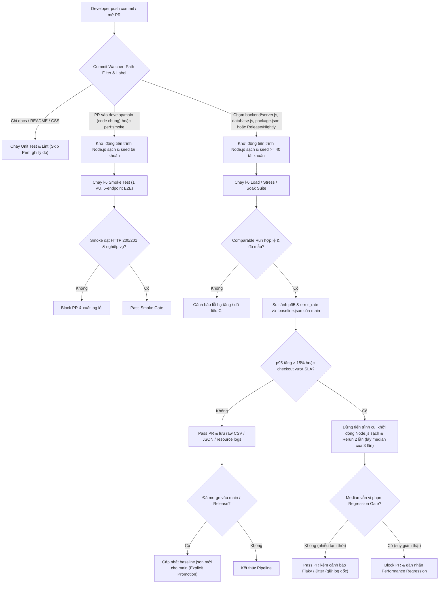

# Đề xuất mô hình Kiểm thử Hiệu năng Liên tục (Continuous Performance Testing Proposal)

> **Cấp độ Bloom:** G9.6 (Đánh giá & Sáng tạo)  
> **Dự án:** EShop SUT (Node.js Express + SQLite)  
> **Học viên:** Trần Ngọc Diễm Thúy — MSSV: `23120367`  
> **Tài liệu tham chiếu:** [README.md](../README.md), [main-report.md](main-report.md), bộ kỹ năng [.agents/skills/](../../.agents/skills/)

Tài liệu này trình bày đề xuất mô hình tích hợp kiểm thử hiệu năng vào đường ống CI/CD (Continuous Integration / Continuous Delivery) trên nền tảng GitHub Actions. Mô hình được thiết kế chuyên biệt dựa trên đặc thù kiến trúc nguyên khối của EShop SUT (Node.js đơn tiến trình, lưu giỏ hàng `userCarts` trong RAM, SQLite nhúng cục bộ) và các phát hiện thực nghiệm từ 4 kịch bản đo đạc (Load, Stress, Spike, Soak).

---

## 1. Cơ chế theo dõi Commit & Bộ lọc thông minh (Commit Watcher & Trigger Decision)

Để tối ưu thời gian phản hồi cho lập trình viên (feedback loop dưới 4 phút) và tránh lãng phí tài nguyên runner cho các thay đổi không liên quan đến hiệu năng backend, pipeline kết hợp **Path Filter** (`paths` trigger / `dorny/paths-filter`) và **PR Labels**:

| Mức kiểm thử | Điều kiện kích hoạt (Path Filter / Branch / Label) | Phạm vi thực thi |
|---|---|---|
| **Chỉ Unit Test & Lint (Skip Perf)** | Thay đổi chỉ nằm trong `README.md`, `docs/**`, `**/*.md`, `frontend-*/**/*.css`, tài nguyên tĩnh giao diện (không sửa logic API hay script k6) và không gắn label `perf:*`. | Chạy unit test/lint; bỏ qua k6 và ghi rõ lý do skip vào GitHub Job Summary để tiết kiệm phút runner. |
| **Smoke Performance Test** | Pull Request nhắm vào `develop` hoặc `main` có thay đổi code ứng dụng ngoài danh mục docs/CSS, hoặc gắn label `perf:smoke`. | Dựng SUT sạch, chạy k6 **Smoke (1 VU, 1 iteration)** kiểm chứng toàn vẹn luồng 5 endpoint (`POST /api/login`, `GET /api/products?search`, `GET /api/products/{id}`, `POST /api/cart`, `POST /api/checkout`), xác minh HTTP 200/201, JWT token, `productId`, `orderId`. |
| **Full Load / Soak Gate** | Đẩy **Release tag** (`v*.*.*`), lịch **Nightly (`schedule` cron)**, PR gắn label `perf:full`, hoặc commit chạm trực tiếp vào `backend/**` (`server.js`, `database.js`, `routes/**`, `package.json`) hoặc `performance*/scripts/**`. | Chạy **Load Baseline** trên PR chạm backend; chạy đầy đủ **Stress / Spike / Soak (10–15 phút)** theo lịch Nightly hoặc trước khi cắt Release tag. |

---

## 2. Quy trình kiểm thử & Cơ chế phát hiện suy giảm p95 (p95 Regression Gate)

1. **Dựng môi trường SUT sạch & cô lập:**
   - Khởi tạo thư mục runtime tạm theo từng CI job, sao chép DB kiểm thử và chạy seed định sẵn (**deterministic seed**, sử dụng 250 tài khoản độc lập từ `data/e2e_test_data.csv`, không dùng chung tài khoản để tránh kích hoạt cơ chế khóa lockout sau 3 lần đăng nhập).
   - Khởi động tiến trình Node.js mới hoàn toàn để reset mảng `userCarts` trong RAM và `login_attempts`, chờ `/api/products` trả HTTP 200 (healthcheck) rồi chạy bước warm-up ngắn trước khi ghi nhận số liệu.
2. **Thực thi k6 & Xác thực tính hợp lệ (Comparable Run):**
   - Chạy k6 trên luồng E2E 5 endpoint, xuất raw CSV, JSON summary, mẫu CPU/RSS RAM và metadata (`source_sha256`, runner OS/CPU).
   - Kiểm tra điều kiện hợp lệ: không có lỗi hạ tầng/port, đủ số mẫu tối thiểu ở từng endpoint để tính `p95` (Type-7 quantile) có ý nghĩa thống kê.
3. **So sánh với Baseline nhánh `main` & Quy tắc Block PR:**
   - Baseline được lưu làm artifact JSON gắn với `(branch: main, runner_profile, source_sha256)`. **Tuyệt đối không tự động ghi đè baseline bằng lần chạy bị lỗi hoặc suy giảm**; việc cập nhật baseline mới chỉ thực hiện tường minh (explicit promotion) sau khi PR được merge vào `main` và đạt tất cả tiêu chí.
   - **Ngưỡng đánh FAIL pipeline (kép: tương đối + tuyệt đối):**
     - `p95` toàn luồng HTTP hoặc E2E flow tăng **> 15%** so với baseline `main` (kèm ngưỡng sàn chênh lệch tuyệt đối tối thiểu `>= 2 ms` trên loopback / `>= 10 ms` trên staging có mạng để tránh nhiễu jitter ở mức mili-giây nhỏ).
     - **HOẶC** `p95` của riêng nút thắt `POST /api/checkout` tăng **> 15%** so với baseline hoặc vượt ngưỡng SLA tuyệt đối (`> 25 ms` trên CI loopback / `> 300 ms` trên môi trường production-like).
     - **HOẶC** `error_rate > 0` (Smoke/Load) / vượt ngưỡng `0.1%`, hoặc RSS tăng tuyến tính bất thường trong Soak Gate.

---

## 3. Sơ đồ luồng hoạt động End-to-End (Mermaid.js)

Do `eshop-sut` là ứng dụng Node.js đơn tiến trình lưu giỏ hàng (`userCarts`) trực tiếp in-memory trên RAM kết hợp SQLite cục bộ nhúng trong tiến trình (không sử dụng cơ sở dữ liệu hay cache container ngoài như PostgreSQL/Redis), sơ đồ bỏ qua bước dựng service container ngoài và thay bằng bước **khởi động tiến trình Node.js sạch** cho mỗi lượt chạy test (kể cả khi rerun).



---

## 4. Phân tích đánh đổi (Trade-offs): Chi phí hạ tầng vs. Cảnh báo giả (False Alarms)

| Khía cạnh | GitHub-hosted Shared Runners (`ubuntu-latest`) | Self-hosted Dedicated Runner |
|---|---|---|
| **Chi phí & Vận hành** | Miễn phí trong hạn mức hoặc trả theo phút; không tốn công bảo trì hạ tầng. | Tốn chi phí thuê máy chủ 24/7, cấu hình bảo mật (cô lập PR fork) và bảo trì runner. |
| **Độ ổn định số liệu (`p95`)** | Thấp hơn do **noisy neighbor** (chia sẻ CPU/I/O với job khác). Với `eshop-sut` có `p95` nền chỉ `7–11 ms`, chỉ cần nhiễu OS scheduling `3–5 ms` đã vượt ngưỡng `+15%`. | Cao và nhất quán do phần cứng, CPU và I/O đĩa (SQLite) được cô lập hoàn toàn; phù hợp làm chuẩn so sánh baseline. |

### Chiến lược cân bằng chi phí và giảm thiểu False Alarms:
1. **Phân tầng tần suất chạy:** Không chạy Full Stress/Soak 10–15 phút trên mọi commit (gây nghẽn hàng đợi CI và đội chi phí). Chỉ chạy **Smoke / Short Load** trên PR và dồn **Stress / Spike / Soak** sang **Nightly** hoặc **Release tag**.
2. **Xác minh bằng Rerun & Trung vị (Median-of-3):** Khi phát hiện `p95` vượt ngưỡng `+15%`, pipeline tự động khởi động lại tiến trình Node.js sạch, **chạy lại 2 lần** trong cùng điều kiện (tổng 3 lần) và dùng **giá trị trung vị (median)** để ra quyết định Block/Pass. Lưu ý: luôn giữ nguyên log của lần fail đầu tiên để phục vụ điều tra, không xóa bằng chứng gốc.
3. **Kết hợp ngưỡng sàn tuyệt đối (Minimum Delta Floor) & Giám sát tài nguyên runner:** Chỉ kết luận regression khi `p95` vừa vượt `+15%` vừa vượt ngưỡng sàn tuyệt đối (`>= 2 ms` loopback / `>= 10 ms` mạng) và CPU/I/O của bản thân runner không bị nghẽn bất thường từ tiến trình ngoài.

---

## 5. Cấu hình mẫu CI Workflow & So sánh chiến lược triển khai

### Cấu hình mẫu đề xuất (`.github/workflows/perf-regression-gate.yml`)

```yaml
name: Performance Regression Gate
on:
  pull_request:
    branches: [main, develop]
    paths:
      - 'backend/**'
      - 'performance_250/scripts/**'
  schedule:
    - cron: '0 19 * * *' # 02:00 UTC+7 hằng ngày cho Stress/Soak

jobs:
  k6-regression-gate:
    runs-on: ubuntu-latest
    steps:
      - uses: actions/checkout@v4
      - uses: actions/setup-node@v4
        with:
          node-version: '20'
      - name: Install backend & k6
        run: |
          npm ci --prefix backend
          sudo snap install k6
      - name: Start clean Node.js SUT & wait healthcheck
        run: |
          node backend/server.js &
          echo $! > sut.pid
          npx wait-on http://127.0.0.1:3000/api/products -t 15000
      - name: Run k6 E2E Load test
        run: |
          k6 run \
            --out csv=raw_result.csv \
            --summary-export=summary.json \
            performance_250/scripts/23120367_Load_20261119.js
      - name: Compare p95 against baseline.json
        run: |
          python3 -c "
          import json, sys
          s = json.load(open('summary.json'))['metrics']
          b = json.load(open('performance_250/baseline.json'))
          p95 = s['http_req_duration']['p(95)']
          err = s['http_req_failed']['rate']
          if err > 0.001 or (p95 > b['p95_ms'] * 1.15 and (p95 - b['p95_ms']) >= 2.0):
              print(f'REGRESSION: p95={p95:.2f}ms vs baseline={b[\"p95_ms\"]}ms, err={err}')
              sys.exit(1)
          print(f'PASS: p95={p95:.2f}ms, err={err}')
          "
      - name: Stop isolated SUT process
        if: always()
        run: kill $(cat sut.pid) || true
```

### Bảng so sánh 3 chiến lược triển khai CI Performance Gate

| Chiến lược | Tốc độ phản hồi (Feedback Loop) | Chi phí Runner | Rủi ro False Alarms |
|---|---|---|---|
| **Mọi Commit** (Chạy full suite trên từng push) | **Chậm** (chờ 5–15 phút/commit, gây nghẽn hàng đợi PR). | **Rất cao** (tiêu tốn phút runner liên tục kể cả khi chỉ sửa docs/CSS). | **Cao** (chạy dày đặc trên shared runner dễ trúng nhiễu CPU/I/O). |
| **PR Path-Filtered** (Smoke/Load khi chạm `backend/**`) | **Nhanh** (chỉ 1–3 phút cho PR liên quan; PR docs/UI được skip tức thì). | **Tối ưu** (chỉ tiêu tốn runner khi có thay đổi ảnh hưởng hiệu năng). | **Trung bình – Thấp** (kết hợp Rerun Median-of-3 và ngưỡng sàn tuyệt đối). |
| **Nightly Scheduled** (Chạy Stress/Spike/Soak định kỳ) | **Trễ** (phát hiện suy giảm sau 12–24 giờ, khó khoanh vùng commit đơn lẻ). | **Thấp – Cố định** (chạy 1 lần/ngày vào giờ thấp điểm). | **Thấp** (ít tranh chấp runner vào ban đêm, phù hợp test dài 10–15 phút). |
