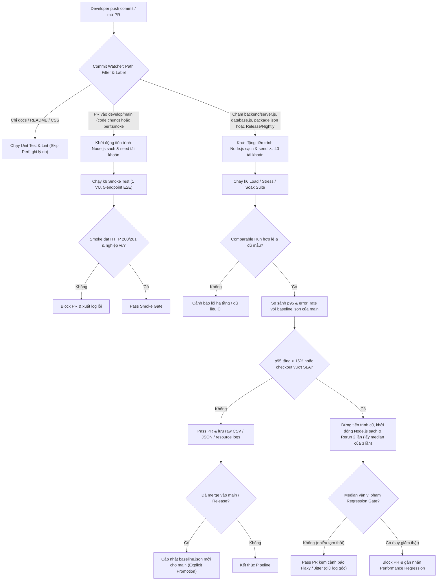

# HW05 — Kiểm thử hiệu năng EShop với k6 (Task 1)

- **MSSV:** 23120367
- **Họ và tên**: Trần Ngọc Diễm Thúy

---

## 1. Môi trường và Khám phá API (API Discovery)

- **Tài liệu tham chiếu:** [api_discovery.md](api_discovery.md), [api_discovery.json](../data/api_discovery.json), [runtime-adaptation.json](../evidence/runtime-adaptation.json), [dependencies.json](../data/dependencies.json).
- **Base URL / Port:** `http://127.0.0.1:3000` (port gốc `3000`).
- **Môi trường backend:** Chạy trên **backend cô lập** tại `performance_250/.runtime/backend/` (chỉ bind loopback `127.0.0.1` và giữ SQLite DB riêng tại `performance_250/.runtime/backend/database.sqlite`, không làm thay đổi `backend/database.sqlite` gốc). Không sử dụng `run_servers.sh` vì script đó gọi `killall node`.
- **SHA256 mã nguồn SUT đã xác minh:**
  - `backend/server.js`: `47573ce5a6bf9a894748d2bb56cc8d1659ad7acd033fdd6db6b3e4d9473eb487`
  - `backend/database.js`: `3366420632bb9c982905b22e3969f69515e39e7a37a4f84eba56ead7e94afed8`
  - `backend/package.json`: `c2ad90d0e4a2a37319fe4d66a70563392f0e06346fb69eb7abbe7c6ff79eb1f3`
  - `backend/package-lock.json`: `ec3f3b2dbf1622f1b1121b9d5916ab0eb74d06ed8c59b16082c52c452eebd814`

### Bảng thông số phần cứng & phần mềm thực tế ([hardware.txt](../evidence/hardware.txt))

| Thông số | Giá trị đo thực tế | Ghi chú |
|---|---|---|
| Hostname | `Thuys-MacBook-Air.local` | Khớp cấu hình máy thực tế |
| Model / Chip | `MacBook Air` (`MacBookAir10,1`), `Apple M1` | `8` cores (`4 Performance + 4 Efficiency`) |
| RAM | `8 GB` (`8,589,934,592 bytes`) | — |
| Hệ điều hành | `macOS 27.0.1` (`Darwin 27.0.0`, `arm64`) | — |
| Công cụ đo & runtime | `k6 v2.1.0` (`darwin/arm64`), `Node.js v22.17.1`, `Python 3.13.12` | `benc-uk/k6-reporter` `3.0.4` (SHA256 `3d981a8f...`) |
| Backend PID (cô lập) | Load: `9177`, Stress: `13339`, Spike: `16013`, Soak: `17608` | Mỗi kịch bản reset/khởi chạy PID sạch |
| Ảnh phần cứng | [hardware.png](../evidence/hardware.png) | Chụp About This Mac / System Information |

### Đặc tính SUT quan sát từ mã nguồn (`backend/server.js`, `backend/database.js`)

- `backend/database.js` xóa toàn bộ bảng (`DROP TABLE IF EXISTS`) và reseed mỗi lần import; vì vậy phải dùng bản sao cô lập và không restart server gốc trong lúc đo.
- Giỏ hàng (`userCarts`) lưu trong RAM tiến trình Node.js; `POST /api/checkout` không đọc và không xóa giỏ hàng sau khi đặt đơn; bảng `products` không có cột tồn kho (stock: N/A).
- `GET /api/products/:id` trả về **HTTP 200 `{}`** khi không tìm thấy sản phẩm, và ép `price` sang kiểu `string` nếu `id` là số chẵn (`row.id % 2 === 0`).
- `GET /api/products?search=...` ghép chuỗi SQL trực tiếp (`LIKE '%${searchQuery}%'`).
- **Cơ chế khóa đăng nhập (Lockout):** Đề bài kỳ vọng khóa sau 3 lần sai, nhưng source code thực tế cộng `login_attempts + 2` và khóa khi `>= 3` trong `180000 ms` (`backend/server.js:54-58`) — tức có thể khóa sau **2 lần sai liên tiếp** (đây là hành vi đọc từ source; không kích hoạt trong các lượt đo tải do CSV dùng tài khoản hợp lệ).

---

## 2. Thiết kế kịch bản kiểm thử và Human Review

### Luồng nghiệp vụ dùng chung (E2E Workflow)

Tất cả các kịch bản (`Load`, `Stress`, `Spike`, `Soak`) dùng chung [workflow.js](../scripts/lib/workflow.js) gồm 5 `group()` theo đúng thứ tự, bao phủ 3 nhóm endpoint:

1. `01_auth_login` (`POST /api/login`) — **Auth-heavy**: lấy Bearer JWT (`token`) và truyền cho các bước sau.
2. `02_read_search` (`GET /api/products?search=<keyword>`) — **Read-heavy**: tìm kiếm theo từ khóa từ CSV.
3. `03_read_detail` (`GET /api/products/:id`) — **Read-heavy**: lấy chi tiết sản phẩm, kiểm tra `id`, `name`, `price` (ép kiểu số cho ID chẵn và đếm `price_string_anomalies`).
4. `04_transaction_cart` (`POST /api/cart`) — **Transactional**: thêm sản phẩm vào giỏ theo dữ liệu detail.
5. `05_transaction_checkout` (`POST /api/checkout`) — **Transactional**: tạo đơn với `total_amount = Number(product.price) * quantity` và `shippingAddress` từ CSV, kiểm tra `orderId > 0`.

### Dữ liệu kiểm thử ([e2e_test_data.csv](../data/e2e_test_data.csv))

- **Nguồn dữ liệu:** **250 tài khoản fixture độc lập** (`hw05.vu0001@example.test` … `hw05.vu0250@example.test`) được seed vào SQLite cô lập qua [reset_db.sh](../scripts/reset_db.sh) và ghi ra `data/e2e_test_data.csv` (251 dòng gồm header; SHA256: `8e2213b6f93b43b345955e805d739dfc63887bead0f6619f1e13919b72d19122`).
- **Cơ chế cấp phát:** `SharedArray` parse CSV ở init context; mỗi VU dùng `rows[vuOffset + __VU - 1]` (mặc định `VU_OFFSET=0`), **không modulo**, dừng ngay trước khi chạy nếu số tài khoản < `max(40, peak VUs)`.
- **Tồn kho:** N/A (schema `products` không có cột stock).

### Ma trận cấu hình các kịch bản (đã hiệu chỉnh cho `performance_250/`)

*Lưu ý: Các ngưỡng `P95_MS`, `ERROR_RATE`, `PEAK_VUS` và `think-time` là giả định ban đầu dùng để kiểm chứng bằng thực nghiệm, không phải kết luận năng lực phần cứng trước khi đo.*

| Kịch bản | Executor | VUs / Stages | Think-time | Thresholds mặc định | Định dạng Report View |
|---|---|---|---|---|---|
| **Load** ([23120367_Load_20261119.js](../scripts/23120367_Load_20261119.js)) | `ramping-vus` | `0 → 10 (30s) → 10 (2m) → 0 (30s)` | `1s ± 50%` jitter (`0.5s–1.5s`) | `p(95) < 500ms` (step & HTTP), `flow_processing_ms p(95) < 2500ms`, error `<= 0.5%`, `checks >= 99.5%`, `flow_completed > 0` | Built-in Web Dashboard ([load_dashboard.html](load/load_dashboard.html)) |
| **Stress** ([23120367_Stress_20261119.js](../scripts/23120367_Stress_20261119.js)) | `ramping-vus` | `0 → 62 (30s) → 125 (45s) → 187 (45s) → 250 (1m) → 250 (1m) → 0 (30s)` | `1s ± 50%` jitter (`0.5s–1.5s`) | `p(95) < 1500ms`, `flow_processing_ms p(95) < 7500ms`, error `<= 1%`, `checks >= 99%`, `flow_completed > 0` | `handleSummary` + `k6-reporter` 3.0.4 classic tabbed HTML ([stress_summary.html](stress/stress_summary.html)) |
| **Spike** ([23120367_Spike_20261119.js](../scripts/23120367_Spike_20261119.js)) | `ramping-vus` | `0 → 10 (30s) → 250 (1s) → 250 (30s) → 10 (1s) → 10 (1m) → 0 (10s)` | `1s ± 50%` jitter (`0.5s–1.5s`) | Như Stress + `http_req_duration{phase:baseline} p(95) < 1500ms`, `http_req_duration{phase:recovery} p(95) < 1500ms`, `recovery_requests > 0` | Custom `spikeReport` HTML ([spike_breakdown.html](spike/spike_breakdown.html)) |
| **Soak** ([23120367_Soak_20261119.js](../scripts/23120367_Soak_20261119.js), bổ sung) | `constant-vus` | `20 VUs` liên tục `600s` (10 phút; hợp lệ `600–900s`) | `1s ± 50%` jitter (`0.5s–1.5s`) | Như Load (`p(95) < 500ms`, error `<= 0.5%`) | Built-in Web Dashboard ([soak_dashboard.html](soak/soak_dashboard.html)) |

### Các phần AI làm sai / thiếu sót, lý do AI mắc lỗi và kết quả khắc phục (Human Review)

Trong quá trình rà soát (`Human Review`) bộ script k6 do AI sinh tự động ban đầu và đối chiếu trực tiếp với mã nguồn `backend/server.js`, `backend/database.js`, đã phát hiện và sửa 10 vấn đề sau (và đồng bộ vào skill `.agents/skills/eshop-k6-performance/` ở commit `ac474c7` và `bfc5a4e`):

| Hạng mục / Vị trí | Lỗi / Thiếu sót của script AI sinh ban đầu | Lý do AI mắc lỗi (nguyên nhân gốc rễ) | Hướng đã sửa & cải thiện |
|---|---|---|---|
| **1. Peak VUs và dữ liệu CSV chưa đủ gây áp lực** (`workflow.js`, `perf.config.json`, `e2e_test_data.csv`) | Bản gốc đặt `PEAK_VUS = 40` (`40` tài khoản). Sau khi nâng thử `120 VUs`, CPU mới đạt `48%`, vẫn chưa đủ gây áp lực. | AI dùng cấu hình an toàn tối thiểu của template (`accounts = 40`) thay vì căn cứ vào công suất thực tế và mục tiêu tìm điểm gãy của Stress/Spike. | Nâng `PEAK_VUS` lên **250 VUs**, `SOAK_VUS = 20`, tạo **250 tài khoản độc lập** vào CSV; chia Stress thành 4 bậc (`62 → 125 → 187 → 250`) và rút đỉnh Spike xuống `30s`. |
| **2. Xử lý tài khoản bị khóa `403` & ẩn log lỗi** (`workflow.js`) | Khi tài khoản bị khóa (`403`), VU không dừng mà tiếp tục gửi `POST /api/login` ở mọi iteration còn lại; console chỉ log `__ITER === 0` nên che mất lần khóa xảy ra ở lần sai thứ 2 (`__ITER === 1`). | AI giả định dữ liệu CSV luôn đúng nên không xử lý trạng thái tài khoản bị khóa; bỏ qua logic `login_attempts + 2 >= 3` của SUT. | Thêm `auth_locked_errors`, bật `accountLocked = true` ở cấp VU khi nhận `403` để ngưng gọi login rác, và mở rộng log lỗi lên `__ITER <= 1`. |
| **3. Check kép làm méo tỷ lệ `checks` & cardinality** (`workflow.js`, `reports.js`) | Gọi 2 hàm `check()` độc lập trên cùng 1 response (`HTTP status ${status}` và `${name}: HTTP and business result`). Lỗi `200 {}` khiến check 1 pass, check 2 fail → `checks` tính thành 50% thay vì 0%. | AI kết hợp kỹ thuật đếm HTTP status vào tên `check()` để tiện đọc trong `spikeReport` mà bỏ qua hệ quả toán học lên metric `checks`. | Gộp còn **1 `check()` duy nhất** cho mỗi request; dùng bộ `Counter` cố định `http_status_*` (`0, 200, 201, 400, 401, 403, 404, 500, other`) để thống kê status. |
| **4. Lỗi gán nhãn pha `recovery` của Spike** (`workflow.js`) | Hàm `phase()` hardcode `elapsed >= 92 ? 'recovery' : elapsed >= 30 ? 'spike' : 'baseline'`, không tự cập nhật khi đổi stage và gán nhầm 10s ramp-down cuối vào `recovery`. | AI tính nhẩm mốc tích lũy bằng tay rồi hardcode, quên tách pha hạ VU về 0. | Tính mốc thời gian động từ `spikeStageDefs`, tách riêng `'ramp_down'`, và thêm threshold `http_req_duration{phase:baseline}` để đối chiếu với `phase:recovery`. |
| **5. Kiểm tra kiểu dữ liệu `price` và ghi nhận lỗi SUT** (`workflow.js`, `csv.js`) | `Number(b.price)` chấp nhận cả `boolean` (`Number(true) === 1`); không lưu bằng chứng ID chẵn trả `price` dạng `string`; `csv.js` chưa chặn ký tự `'` ở `search`. | AI chỉ tập trung chống crash script mà không gắn metric thu thập bằng chứng bug SUT và bỏ qua lỗ hổng SQL ghép chuỗi ở `server.js:144`. | Siết kiểm tra kiểu cho `b.price`, thêm `price_string_anomalies` đếm số lần `typeof product.price === 'string'`, kiểm tra JWT 3 phần + `user.id`, và chặn `'`, `;` trong `csv.js`. |
| **6. Think-time cố định & gộp vào `flow_duration_ms`** (`workflow.js`) | Dùng `sleep(1)` cố định gây lock-step giữa các VU; `flow_duration_ms` cộng cả ~4000ms `sleep` khiến khó thấy thời gian xử lý thuần túy của server. | AI chọn `sleep(think)` đơn giản và đo tổng `Date.now() - started` mà không tách client wait khỏi server processing. | Thêm jitter `±50%` quanh `THINK_SECONDS` và bổ sung `flow_processing_ms` (đã trừ tổng `sleptMs`) bên cạnh `flow_duration_ms`. |
| **7. Ngưỡng `thresholds` quá lỏng cho `Load`/`Soak`** (`workflow.js`) | Dùng chung `P95_MS=1500` và `ERROR_RATE=0.01` cho mọi kịch bản trên `127.0.0.1`. | AI đặt một budget khởi đầu chung cho cả 4 kịch bản để tránh false positive mà không phân biệt tải bình thường với tải cực hạn. | Phân tầng mặc định: `Load`/`Soak` dùng `p(95) < 500ms`, `error <= 0.5%`; `Stress`/`Spike` giữ `p(95) < 1500ms`, `error <= 1%`. |
| **8. Báo cáo Spike gây hiểu nhầm `group()` & mất `stdout`** (`reports.js`, `Stress`, `Spike`) | `spikeReport` đặt tiêu đề `group()` nhưng đọc `step_*_ms`; gộp status `0` với `>=400`; `handleSummary` của `Stress`/`Spike` làm mất summary trên terminal. | AI tối giản `handleSummary` chỉ xuất file HTML và dùng nhãn cột tắt. | Đổi nhãn `Step / Group (step_*_ms)`, tách `Status 0 (Network / Timeout)`, thêm bảng `Baseline / Spike / Recovery`, và thêm `formatConsoleSummary` ra `stdout`. |
| **9. Hỗ trợ phân vùng VU khi chạy nhiều runner** (`workflow.js`) | `rows[__VU - 1]` mặc định chạy từ index `0`. | Thiết kế ban đầu giả định chỉ chạy 1 tiến trình k6 local duy nhất. | Bổ sung `VU_OFFSET` (mặc định `0`) và kiểm tra `rows.length >= vuOffset + maxVUs`. |
| **10. Lỗi zombie PID & `Address already in use` trên macOS** (`perf.py`) | Khi chạy nhiều bước trên macOS, `owned_pid()` gặp tiến trình con zombie `(node)` hoặc PID cũ đã thoát bị báo lỗi không cho `reset_db.sh` chạy tiếp, và `probe.bind` dính `TIME_WAIT` (`Errno 48`). | `perf.py` không `waitpid` khi tắt child process trên macOS và dùng socket probe không bật `SO_REUSEADDR`. | Gọi `os.waitpid(..., WNOHANG)` trong `owned_pid()`/`stop()`, tự dọn `.runtime/backend.pid` nếu PID không còn thuộc `server.js`, và bật `SO_REUSEADDR` + retry bind ngắn trong `reset()`. |

### Kiểm chứng Smoke trước tải lớn

- `./scripts/run.sh Load --smoke` (1 VU, 1 iteration, PID `6213`): `5/5` checks đạt (`100%`), `flow_completed = 1`, `flow_processing_ms = 19 ms`, `http_status_200 = 5`, `error_rate = 0.0` ([Smoke_Load.analysis.md](../analysis/Smoke_Load.analysis.md)).

---

## 3. Kết quả đo tải và Tài nguyên hệ thống (Load, Stress, Spike)

> [!NOTE]
> - Toàn bộ số liệu latency (`ms`, phân vị Type-7) và throughput dưới đây được trích trực tiếp từ các phân tích raw CSV tại [Load.analysis.md](../analysis/Load.analysis.md), [Stress.analysis.md](../analysis/Stress.analysis.md), [Spike.analysis.md](../analysis/Spike.analysis.md) và resource samples tại `evidence/*_resources.analysis.json`.
> - **Ghi chú định dạng log:** Đề bài gốc nhắc `.jtl` (JMeter), nhưng bài tập sử dụng k6 nên giữ nguyên định dạng native CSV của k6 (`*_raw.csv`, không đổi đuôi sang `.jtl`) theo quy ước hướng dẫn và xác nhận của TA.

### 3.1. Tổng hợp thực thi và Tài nguyên Backend

| Kịch bản | Thời gian chạy (UTC) | Exit Code | Raw CSV & SHA256 | Báo cáo HTML & JSON | Backend CPU max / RSS (MiB) | Ảnh màn hình |
|---|---|---|---|---|---|---|
| **Load** (`10 VUs`) | `2026-11-19T10:38:22Z` → `10:41:25Z` (`182.861s`) | `0` (Pass) | [23120367_Load_raw.csv](../raw_logs/23120367_Load_raw.csv) (`a78c552b...`) | [load_dashboard.html](load/load_dashboard.html), [Load_summary.json](../raw_logs/Load_summary.json) | CPU max `10.0%` \| RSS `55.78 → 68.83` (`+13.05`, peak `68.88`) | [Load_screen.png](../evidence/Load_screen.png) |
| **Stress** (`250 VUs`) | `2026-11-19T10:47:35Z` → `10:52:08Z` (`272.895s`) | `0` (Pass) | [23120367_Stress_raw.csv](../raw_logs/23120367_Stress_raw.csv) (`43283b65...`) | [stress_summary.html](stress/stress_summary.html), [Stress_summary.json](../raw_logs/Stress_summary.json) | CPU max `54.6%` \| RSS `53.06 → 76.06` (`+23.00`, peak `105.02`) | [Stress_screen.png](../evidence/Stress_screen.png) |
| **Spike** (`250 VUs`) | `2026-11-19T10:53:03Z` → `10:55:20Z` (`135.780s`) | `0` (Pass) | [23120367_Spike_raw.csv](../raw_logs/23120367_Spike_raw.csv) (`1c89c7a4...`) | [spike_breakdown.html](spike/spike_breakdown.html), [Spike_summary.json](../raw_logs/Spike_summary.json) | CPU max `53.0%` \| RSS `56.14 → 69.95` (`+13.81`, peak `102.69`) | [Spike_screen.png](../evidence/Spike_screen.png) |

*Commit kết quả đo tải: `78a4875`. Lệnh thực thi chuẩn:* `./scripts/run.sh <Load|Stress|Spike> --pause-for-evidence`.

### 3.2. Kết quả chi tiết theo Endpoint và End-to-End Flow

#### A. Kịch bản Load (`10 VUs`, cửa sổ đo `182.861s`, `1,520` HTTP requests)

| Scope | Samples | min (ms) | avg (ms) | med (ms) | p90 (ms) | p95 (ms) | p99 (ms) | max (ms) | RPS | Error rate |
|---|---:|---:|---:|---:|---:|---:|---:|---:|---:|---:|
| **HTTP overall** | 1,520 | 0.760 | 3.801 | 3.360 | 6.371 | 7.239 | 8.828 | 33.743 | 8.312 | `0.000` |
| `login` | 304 | 2.448 | 4.417 | 4.256 | 5.509 | 5.802 | 8.176 | 33.743 | 1.662 | `0.000` |
| `search` | 304 | 0.760 | 2.276 | 2.202 | 3.027 | 3.528 | 5.478 | 7.386 | 1.662 | `0.000` |
| `detail` | 304 | 0.865 | 2.197 | 2.025 | 2.970 | 3.442 | 5.054 | 7.570 | 1.662 | `0.000` |
| `cart` | 304 | 1.579 | 3.671 | 3.503 | 4.640 | 4.953 | 6.522 | 30.188 | 1.662 | `0.000` |
| `checkout` | 304 | 3.086 | 6.445 | 6.177 | 7.953 | 8.606 | 10.744 | 32.365 | 1.662 | `0.000` |

- **End-to-end flow:** `attempts = 304`, `completed = 304`, `interrupted = 0`, `flow error_rate = 0.0`.
- **Throughput nghiệp vụ:** `completed_per_second = 1.662 checkouts/s` (khác với HTTP overall `8.312 req/s`).
- **Flow latency:** `flow_duration_ms` (gồm think-time) `avg = 3,997.91 ms`, `p95 = 4,973.65 ms`; `flow_processing_ms` (thuần xử lý) `avg = 25.502 ms`, `p95 = 30.767 ms`, `max = 57.269 ms`.

#### B. Kịch bản Stress (`62 → 125 → 187 → 250 VUs`, cửa sổ đo `272.895s`, `44,360` HTTP requests)

| Scope | Samples | min (ms) | avg (ms) | med (ms) | p90 (ms) | p95 (ms) | p99 (ms) | max (ms) | RPS | Error rate |
|---|---:|---:|---:|---:|---:|---:|---:|---:|---:|---:|
| **HTTP overall** | 44,360 | 0.226 | 3.563 | 2.868 | 6.956 | 8.556 | 12.379 | 40.729 | 162.553 | `0.000` |
| `login` | 8,872 | 0.553 | 4.176 | 3.460 | 7.352 | 9.114 | 13.011 | 37.682 | 32.511 | `0.000` |
| `search` | 8,872 | 0.230 | 2.507 | 1.736 | 5.297 | 6.948 | 10.906 | 35.302 | 32.511 | `0.000` |
| `detail` | 8,872 | 0.226 | 2.562 | 1.735 | 5.550 | 7.213 | 11.185 | 32.153 | 32.511 | `0.000` |
| `cart` | 8,872 | 0.435 | 2.782 | 2.448 | 4.513 | 5.310 | 7.278 | 32.188 | 32.511 | `0.000` |
| `checkout` | 8,872 | 1.095 | 5.786 | 5.208 | 9.113 | 10.624 | 14.312 | 40.729 | 32.511 | `0.000` |

- **End-to-end flow:** `attempts = 8,872`, `completed = 8,872`, `interrupted = 0`, `flow error_rate = 0.0`.
- **Throughput nghiệp vụ:** `completed_per_second = 32.511 checkouts/s` (HTTP overall `162.553 req/s`).
- **Flow latency:** `flow_duration_ms` `avg = 4,022.65 ms`, `p95 = 4,969.00 ms`; `flow_processing_ms` `avg = 21.552 ms`, `p95 = 33.096 ms`, `max = 66.822 ms`.
- **Nhận xét vùng tải:** Ở đỉnh `250 VUs`, CPU backend đạt `54.6%`, `p95` chỉ `8.556 ms` và `0%` lỗi. Như vậy, **`250 VUs` là mức tải cao nhất đã kiểm chứng (*highest verified load*)**, chưa chạm điểm gãy (*breaking point*) của hệ thống trên Apple M1.

#### C. Kịch bản Spike (`10 → 250 → 10 VUs`, cửa sổ đo `135.780s`, `9,185` HTTP requests)

| Scope | Samples | min (ms) | avg (ms) | med (ms) | p90 (ms) | p95 (ms) | p99 (ms) | max (ms) | RPS | Error rate |
|---|---:|---:|---:|---:|---:|---:|---:|---:|---:|---:|
| **HTTP overall** | 9,185 | 0.320 | 3.247 | 2.531 | 6.267 | 7.901 | 11.780 | 47.968 | 67.646 | `0.000` |
| `login` | 1,837 | 0.701 | 3.464 | 2.715 | 5.980 | 7.587 | 12.230 | 47.968 | 13.529 | `0.000` |
| `search` | 1,837 | 0.320 | 2.361 | 1.672 | 4.766 | 6.270 | 9.940 | 34.259 | 13.529 | `0.000` |
| `detail` | 1,837 | 0.330 | 2.478 | 1.704 | 5.176 | 6.925 | 11.356 | 45.565 | 13.529 | `0.000` |
| `cart` | 1,837 | 0.548 | 2.650 | 2.267 | 4.489 | 5.201 | 7.023 | 14.096 | 13.529 | `0.000` |
| `checkout` | 1,837 | 1.478 | 5.280 | 4.651 | 8.518 | 9.802 | 14.994 | 43.014 | 13.529 | `0.000` |

- **End-to-end flow:** `attempts = 1,837`, `completed = 1,837`, `interrupted = 0`, `flow error_rate = 0.0`.
- **Throughput nghiệp vụ:** `completed_per_second = 13.529 checkouts/s` (HTTP overall `67.646 req/s`).
- **Flow latency:** `flow_duration_ms` `avg = 4,033.17 ms`, `p95 = 4,958.00 ms`; `flow_processing_ms` `avg = 20.082 ms`, `p95 = 30.885 ms`, `max = 68.313 ms`.
- **Đối chiếu pha Baseline vs Recovery (từ `Spike_summary.json`):**
  - `phase:baseline`: `avg = 4.347 ms`, `p95 = 8.274 ms`, `max = 22.054 ms`.
  - `phase:recovery`: `avg = 4.068 ms`, `p95 = 8.545 ms`, `max = 19.940 ms`.
  - Kết luận: Hệ thống phục hồi hoàn toàn về mức nền ngay sau cú sốc 250 VUs (`p95` chênh lệch `0.271 ms`, không rớt request nào).

---

## 4. Ngưỡng chịu tải bền vững (Endurance / Soak Threshold)

- **Cấu hình thực thi:** `SOAK_VUS=20`, duy trì liên tục **`605.298s`** (~10 phút, **không reset giữa lúc đo**), Backend PID `17608`.
- **Artifacts:** [23120367_Soak_raw.csv](../raw_logs/23120367_Soak_raw.csv) (SHA256 `ec67cb4c...`), [Soak_summary.json](../raw_logs/Soak_summary.json), [soak_dashboard.html](soak/soak_dashboard.html), [Soak.analysis.md](../analysis/Soak.analysis.md), [Soak_resources.csv](../evidence/Soak_resources.csv), [Soak_screen.png](../evidence/Soak_screen.png).

### Kết quả đo Soak (`20 VUs`, `11,975` HTTP requests, `2,395` checkouts)

| Scope | Samples | min (ms) | avg (ms) | med (ms) | p90 (ms) | p95 (ms) | p99 (ms) | max (ms) | RPS | Error rate |
|---|---:|---:|---:|---:|---:|---:|---:|---:|---:|---:|
| **HTTP overall** | 11,975 | 0.447 | 4.040 | 3.533 | 7.326 | 8.183 | 10.403 | 35.247 | 19.784 | `0.000` |
| `login` | 2,395 | 1.442 | 4.768 | 4.557 | 6.239 | 7.480 | 11.942 | 25.245 | 3.957 | `0.000` |
| `search` | 2,395 | 0.646 | 2.406 | 2.136 | 3.412 | 4.665 | 8.155 | 24.978 | 3.957 | `0.000` |
| `detail` | 2,395 | 0.447 | 2.353 | 2.115 | 3.302 | 4.405 | 6.832 | 26.405 | 3.957 | `0.000` |
| `cart` | 2,395 | 1.037 | 3.651 | 3.630 | 4.719 | 5.256 | 6.995 | 14.870 | 3.957 | `0.000` |
| `checkout` | 2,395 | 1.971 | 7.024 | 7.071 | 8.815 | 9.626 | 11.985 | 35.247 | 3.957 | `0.000` |

- **Flow:** `attempts = 2,395`, `completed = 2,395`, `completed_per_second = 3.957 checkouts/s`, `flow_processing_ms p95 = 33.570 ms`, `error_rate = 0.0`.
- **Tài nguyên & Tiêu chí ổn định:**
  - **Tiêu chí ổn định:** `p95 < 500 ms` (thực tế `8.183 ms`), `error_rate <= 0.5%` (thực tế `0%`), CPU trung bình thấp (max `23.7%`), không bị suy giảm độ trễ theo thời gian.
  - **Biến động RAM (RSS):** Tăng ròng **`+38.44 MiB`** từ `47.72 MiB` lên `86.16 MiB` (peak `90.00 MiB`) sau `2,395` lượt `POST /api/cart` do giỏ hàng `userCarts` trong RAM không được dọn khi checkout.
  - **Kết luận ngưỡng:** Với `20 VUs` trong 10 phút (`19.78 req/s`, `3.96 checkouts/s`), hệ thống ổn định về latency và error rate nhưng có hiện tượng tích lũy RSS. **`20 VUs` là mức tải bền vững đã kiểm chứng (*highest verified sustained load*)**; cần lưu ý giới hạn RAM nếu kéo dài thời gian chạy hàng giờ mà chưa sửa lỗi xóa giỏ hàng.

---

## 5. Đối chiếu phân tích AI và săn lỗi diễn giải (Task 2)

- **Tài liệu chi tiết:** [ai-verification.md](../analysis/ai-verification.md)
- **Raw CSV & SHA256 đối chiếu:**
  - `raw_logs/23120367_Load_raw.csv` (`a78c552b144202b0d1082e67db7f977c24c7109e88f51f48209b521a9486f61e`)
  - `raw_logs/23120367_Stress_raw.csv` (`43283b655b6172410c6f5637e794e5d6bd81e57212964dd9b7eabb8cb1fa9878`)
  - `raw_logs/23120367_Spike_raw.csv` (`1c89c7a4cf73814ef1d3092447e30681e5bcbd4558f47b72c052368d0c6212cc`)
  - `raw_logs/23120367_Soak_raw.csv` (`ec67cb4c41df587980a34759fa86ffd844c4cc14a95490452f235c728c23fec9`)
- **Công cụ đối chiếu độc lập:** [analyze_raw.py](../scripts/analyze_raw.py) (Type-7 linear quantiles, `ms`, `error_rate` dạng `0..1`) và [analyze_resources.py](../scripts/analyze_resources.py).
- **Lưu ý kiến trúc SUT thực tế:** `eshop-sut` dùng **SQLite** (`backend/database.js`, `sqlite3`) cho `users`, `products`, `categories`, `orders`, `coupons`; chỉ riêng giỏ hàng (`userCarts`) lưu **in-memory trên RAM** tiến trình Node.js (`backend/server.js:14`).

### 5.1. Đối chiếu phân tích đầu tiên của AI với Raw CSV Log

Phân tích đầu tiên của AI đọc trực tiếp từ `analysis/*.analysis.md`, `evidence/*_resources.analysis.json`, `backend/server.js` và `backend/database.js`. Các con số tổng hợp AI trích xuất khớp với `analyze_raw.py`, nhưng vẫn có điểm thiếu sót về tách pha (windowing) và bỏ sót metric bất thường dữ liệu:

| Chỉ số / Nhận định của AI | Giá trị trích xuất từ Raw CSV Log | Đánh giá | Giải thích nguyên nhân kỹ thuật |
|---|---|---|---|
| **Load** (`8.31 HTTP RPS`, `1.66 checkout/s`, `p95 = 7.24 ms`, `error = 0.0`) | `23120367_Load_raw.csv` (`a78c552b...`), `1,520` samples, cửa sổ `182.861s`: HTTP `p95 = 7.239 ms`, `rps = 8.312`, `completed/s = 1.662`, `error_rate = 0.0` | **Chính xác** | AI trích đúng số liệu Type-7 từ `Load.analysis.md`, tách đúng HTTP RPS với completed checkout/s và giữ đơn vị `ms`. |
| **Stress** (`162.55 HTTP RPS`, `32.51 checkout/s`, `p95 = 8.56 ms`, `p99 = 12.38 ms`, `0%` lỗi) | `23120367_Stress_raw.csv` (`43283b65...`), `44,360` samples, cửa sổ `272.895s`: HTTP `p95 = 8.556 ms`, `p99 = 12.379 ms`, `rps = 162.553`, `completed/s = 32.511`, `error = 0.0` | **Chính xác (có ghi chú thận trọng)** | Số liệu chuẩn xác; AI cũng nhận định đúng rằng `0%` lỗi ở 250 VUs chưa phải là ngưỡng trần tối đa (breaking point). |
| **Spike** (`67.65 HTTP RPS` toàn cửa sổ, `p95 = 7.90 ms`, `p99 = 11.78 ms`) | `23120367_Spike_raw.csv` (`1c89c7a4...`), `9,185` samples, cửa sổ `135.780s`: HTTP `p95 = 7.901 ms`, `rps = 67.646`. Trong `Spike_summary.json`: `baseline p95 = 8.274 ms`, `recovery p95 = 8.545 ms` | **Thiếu tách pha (Incomplete windowing)** | Số trung bình toàn run đúng, nhưng AI chưa tách riêng pha `baseline`, pha đỉnh `spike` (30s ở 250 VUs) và pha `recovery` nên không phản ánh RPS đỉnh thực sự trong cú sốc tải. |
| **Soak** (`19.78 HTTP RPS`, `p95 = 8.18 ms`, RSS `+38.44 MiB` trong `605.3s`) | `23120367_Soak_raw.csv` (`ec67cb4c...`), `11,975` samples, `605.298s`; `Soak_resources.analysis.json`: `47.72 → 86.16 MiB` (`+38.44 MiB`, peak `90.00 MiB`) | **Chính xác (chưa tách warm-up vs steady-state)** | Số liệu khớp hoàn toàn và AI thận trọng không kết luận vội memory leak chỉ từ RSS, nhưng chưa tách nửa đầu vs nửa sau Soak để kiểm tra độ trôi `p95` theo thời gian. |
| **Nút thắt số 1 & 2 (`POST /api/checkout`, `POST /api/login`)** | `checkout p95`: Load `8.606`, Stress `10.624`, Spike `9.802`, Soak `9.626 ms`; `login p95`: Load `5.802`, Stress `9.114`, Spike `7.587`, Soak `7.480 ms` | **Chính xác** | Hai endpoint có thao tác ghi SQLite (`INSERT INTO orders`, `UPDATE users`) luôn có `p95`/`p99` cao nhất, nhưng ở tải đo hiện tại độ trễ vẫn dưới `15 ms`. |
| **Bỏ sót bất thường kiểu dữ liệu `price` dạng `string`** | `*_summary.json` metric `price_string_anomalies`: tổng **5,361 lần** (`Load: 123`, `Stress: 3,542`, `Spike: 743`, `Soak: 953`) | **Thiếu sót (Omission)** | AI bỏ qua metric ghi nhận lỗi không nhất quán kiểu dữ liệu ở `GET /api/products/:id` (`server.js:162`: ID chẵn trả `price` dạng `string`). |

### 5.2. Đánh giá tính khả thi của các đề xuất tối ưu hóa (Optimization Feasibility)

| Đề xuất thực tế của AI | Phân loại | Bằng chứng mã nguồn / Thực nghiệm | Phân tích kỹ thuật & Trade-off |
|---|---|---|---|
| **1. Xóa `userCarts[userId]` sau checkout & chuyển sang SQLite/Redis** | **Khả thi một phần (Xóa RAM: Feasible; Redis: Unverified)** | `server.js:14, 290-309`; Soak RSS tăng `+38.44 MiB` sau `2,395` checkout | `delete userCarts[userId]` (hoặc `= []`) sau `INSERT INTO orders` là sửa đơn giản, triệt tiêu tích lũy RAM. Tuy nhiên stack hiện tại không có Redis (`package.json`), đưa Redis vào làm tăng độ phức tạp hạ tầng không cần thiết cho ứng dụng đơn node. |
| **2. Bật SQLite WAL mode (`journal_mode=WAL`, `synchronous=NORMAL`, `busy_timeout=5000`)** | **Khả thi (cần đo kiểm chứng)** | `database.js:5` đang mở kết nối SQLite mặc định (rollback journal) | Cho phép đọc-ghi đồng thời và giảm contention khi mở rộng tải ghi `checkout`/`login` > 250 VUs. Trade-off: phát sinh file `-wal`/`-shm` và chưa thể hiện tác động rõ ở mức 250 VUs hiện tại (`p95 = 8.56 ms`, `0%` lỗi). |
| **3. Tạo Index `users(email)`, `orders(user_id)` & tham số hóa `search`** | **Tham số hóa: Khả thi bắt buộc; Index: Cần `EXPLAIN QUERY PLAN`** | `database.js:50-81`; `server.js:144` ghép chuỗi `LIKE '%${searchQuery}%'` | Tham số hóa query `search` là bắt buộc để tránh SQLi/lỗi `500` khi gặp ký tự `'`. Với `users(email)` và `orders(user_id)`, index hợp lý khi dữ liệu lớn nhưng trên 252 user hiện tại hiệu năng chưa khác biệt. Lưu ý: index B-tree trên `products(name)` **không** tối ưu được `LIKE '%keyword%'` (wildcard đầu); chỉ `FTS5` mới xử lý được nếu catalog lớn. |
| **4. Tránh `UPDATE users` dư thừa khi `login` thành công** | **Khả thi (Feasible)** | `server.js:46-50` luôn chạy `UPDATE users SET login_attempts = 0, locked_until = NULL` | Thêm điều kiện `if (user.login_attempts > 0 || user.locked_until !== null)` giúp loại bỏ 100% thao tác ghi DB không cần thiết ở luồng login hợp lệ, giảm khóa ghi SQLite cạnh tranh với `checkout`. |
| **5. Bounded LRU Cache + TTL cho `GET /api/products` và `:id`** | **Khả thi nhưng ưu tiên thấp (Low ROI hiện tại)** | `server.js:141-165`; `detail p95 = 7.21 ms`, `search p95 = 6.95 ms` ở Stress | Bảng `products` hiện chỉ có 5 dòng và độ trễ đọc đã rất thấp (`~2.5 ms` avg). Thêm cache phải xử lý invalidation ở cả `POST/PUT/DELETE /api/products` và `POST /api/admin/import-products` (`server.js:167-241`), dễ phát sinh bug dữ liệu cũ nếu không cần thiết. |

---

## 6. Lỗi và vấn đề hiệu năng phát hiện được

Các issue dưới đây đã có **bằng chứng định lượng thực tế** từ 4 lượt đo trong `performance_250/` và đã được tạo trên GitHub:

1. **[Issue #1 — Kiểu dữ liệu `price` không nhất quán ở `GET /api/products/:id` (ID chẵn trả `string`)](https://github.com/thuytranj/HW05-Performance-Testing/issues/1)**
   - **Bằng chứng đo được:** Metric `price_string_anomalies` ghi nhận **5,361 lần** (`Load`: 123, `Stress`: 3,542, `Spike`: 743, `Soak`: 953) với sản phẩm `id = 2` và `4`.
   - **Nguyên nhân:** `backend/server.js:162` (`if (row.id % 2 === 0) row.price = row.price.toString();`), mâu thuẫn với schema `price INTEGER` (`backend/database.js:67`) và `GET /api/products`.
   - **Ảnh bằng chứng:** [Stress_screen.png](../evidence/Stress_screen.png).

2. **[Issue #2 — Tích lũy bộ nhớ RAM (`userCarts`) do `POST /api/checkout` không xóa giỏ hàng](https://github.com/thuytranj/HW05-Performance-Testing/issues/2)**
   - **Bằng chứng đo được:** RSS tăng ròng ở cả 4 lượt chạy; rõ nhất ở **Soak (`20 VUs`, 605s, `2,395` checkout)** tăng từ `47.72 MiB` lên `86.16 MiB` (**`+38.44 MiB` net**, peak `90.00 MiB`), và **Stress (`250 VUs`, `8,872` cart)** chạm đỉnh **`105.02 MiB`** (`+23.00 MiB` net).
   - **Nguyên nhân:** `backend/server.js:14, 290-309` lưu `userCarts[userId]` trong RAM và chỉ `push`, không xóa sau khi checkout.
   - **Ảnh bằng chứng:** [Soak_screen.png](../evidence/Soak_screen.png), [Stress_screen.png](../evidence/Stress_screen.png).

*(Các lỗi khác chỉ đọc thấy từ mã nguồn như `200 {}` khi product không tồn tại, lockout sau 2 lần sai, SQLi tại `search`, checkout tin `total_amount` client chưa kích hoạt trong các lượt đo này và không báo cáo thành lỗi đã tái hiện nếu chưa có reproduction riêng).*

---

## 7. Kết luận và Đề xuất Continuous Performance Testing (CPT)

> [!NOTE]
> Phần dưới đây là **mô hình đề xuất (proposal)** tích hợp trên GitHub Actions cho `eshop-sut`, được thiết kế dựa trên đặc tính đo đạc của luồng E2E 5 endpoint và hiện trạng mã nguồn; đây không phải bằng chứng về một pipeline CI/CD đã triển khai thực tế.

### 7.1. Cơ chế theo dõi Commit & Bộ lọc thông minh (Commit Watcher & Trigger Decision)

Để tối ưu thời gian phản hồi cho developer và tránh lãng phí runner cho các thay đổi không liên quan đến hiệu năng API, pipeline GitHub Actions kết hợp **Path Filter** (`dorny/paths-filter` / `paths` trigger) và **PR Label**:

| Mức kiểm thử | Điều kiện kích hoạt (Path Filter / Branch / Label) | Phạm vi thực thi |
|---|---|---|
| **Chỉ Unit Test & Lint (Skip Perf)** | Thay đổi chỉ nằm trong `README.md`, `docs/**`, `**/*.md`, `frontend-*/**/*.css`, tài nguyên tĩnh giao diện (không sửa logic API hay script k6) và không gắn label `perf:*`. | Chạy unit test/lint; bỏ qua k6 và ghi rõ lý do skip vào GitHub Job Summary. |
| **Smoke Performance Test** | Pull Request nhắm vào `develop` hoặc `main` có thay đổi code ứng dụng ngoài danh mục docs/CSS, hoặc gắn label `perf:smoke`. | Dựng SUT sạch, chạy k6 **Smoke (1 VU, 1 iteration)** kiểm chứng toàn vẹn luồng 5 endpoint (`POST /api/login`, `GET /api/products?search`, `GET /api/products/{id}`, `POST /api/cart`, `POST /api/checkout`), xác minh HTTP 200/201, JWT token, `productId`, `orderId`. |
| **Full Load / Soak Gate** | Đẩy **Release tag** (`v*.*.*`), lịch **Nightly (`schedule` cron)**, PR gắn label `perf:full`, hoặc commit chạm trực tiếp vào `backend/**` (`server.js`, `database.js`, `routes/**`, `controllers/**`, `middleware/**`, `package.json`, `package-lock.json`) hoặc `performance*/scripts/**`. | Chạy **Load Baseline** trên PR chạm backend; chạy đầy đủ **Stress / Spike / Soak (10–15 phút)** theo lịch Nightly hoặc trước khi cắt Release tag. |

---

### 7.2. Quy trình kiểm thử & Cơ chế phát hiện suy giảm p95 (p95 Regression Gate)

1. **Dựng môi trường SUT sạch & cô lập:**
   - Khởi tạo thư mục runtime tạm theo từng CI job, sao chép DB kiểm thử và chạy seed định sẵn (**deterministic seed**, tối thiểu 40+ tài khoản tổng hợp độc lập theo từng VU, không dùng chung tài khoản để tránh khóa lockout 180,000 ms).
   - Khởi động tiến trình Node.js mới hoàn toàn để reset `userCarts` trong RAM và `login_attempts`, chờ `/api/products` trả HTTP 200 (healthcheck) rồi chạy bước warm-up ngắn trước khi ghi nhận số liệu.
2. **Thực thi k6 & Xác thực tính hợp lệ (Comparable Run):**
   - Chạy k6 trên luồng E2E 5 endpoint, xuất raw CSV, JSON summary, `ps` CPU/RSS samples và metadata (`source_sha256`, runner OS/CPU).
   - Kiểm tra điều kiện hợp lệ: không có lỗi hạ tầng/port, đủ số mẫu tối thiểu ở từng endpoint để tính `p95` (Type-7 quantile) có ý nghĩa thống kê.
3. **So sánh với Baseline nhánh `main` & Quy tắc Block PR:**
   - Baseline được lưu làm artifact/JSON gắn với `(branch: main, runner_profile, source_sha256)`. **Tuyệt đối không tự động ghi đè baseline bằng lần chạy bị lỗi hoặc suy giảm**; việc cập nhật baseline mới chỉ thực hiện tường minh (explicit promotion) sau khi PR được merge vào `main` và đạt tất cả tiêu chí.
   - **Ngưỡng đánh FAIL pipeline (kép: tương đối + tuyệt đối):**
     - `p95` toàn luồng HTTP hoặc E2E flow tăng **> 15%** so với baseline `main` (kèm ngưỡng sàn chênh lệch tuyệt đối tối thiểu `>= 2 ms` trên loopback / `>= 10 ms` trên staging có mạng để tránh nhiễu jitter ở mức mili-giây nhỏ).
     - **HOẶC** `p95` của riêng nút thắt `POST /api/checkout` tăng **> 15%** so với baseline hoặc vượt ngưỡng SLA tuyệt đối (`> 25 ms` trên CI loopback / `> 300 ms` trên môi trường production-like).
     - **HOẶC** `error_rate > 0` (Smoke/Load) / vượt ngưỡng `0.1%`, hoặc RSS tăng tuyến tính bất thường trong Soak Gate.

---

### 7.3. Sơ đồ luồng hoạt động End-to-End (Mermaid.js)

Do `eshop-sut` là ứng dụng Node.js đơn tiến trình lưu giỏ hàng (`userCarts`) trực tiếp in-memory trên RAM kết hợp SQLite cục bộ nhúng trong tiến trình (không sử dụng cơ sở dữ liệu hay cache container ngoài như PostgreSQL/Redis), sơ đồ bỏ qua bước dựng service container ngoài và thay bằng bước **khởi động tiến trình Node.js sạch** cho mỗi lượt chạy test (kể cả khi rerun).



---

### 7.4. Phân tích đánh đổi (Trade-offs): Chi phí hạ tầng vs. Cảnh báo giả (False Alarms)

| Khía cạnh | GitHub-hosted Shared Runners (`ubuntu-latest`) | Self-hosted Dedicated Runner |
|---|---|---|
| **Chi phí & Vận hành** | Miễn phí trong hạn mức hoặc trả theo phút; không tốn công bảo trì hạ tầng. | Tốn chi phí thuê máy chủ 24/7, cấu hình bảo mật (cô lập PR fork) và bảo trì runner. |
| **Độ ổn định số liệu (`p95`)** | Thấp hơn do **noisy neighbor** (chia sẻ CPU/I/O với job khác). Với `eshop-sut` có `p95` nền chỉ `7–11 ms`, chỉ cần nhiễu OS scheduling `3–5 ms` đã vượt ngưỡng `+15%`. | Cao và nhất quán do phần cứng, CPU và I/O đĩa (SQLite) được cô lập hoàn toàn; phù hợp làm chuẩn so sánh baseline. |

**Chiến lược cân bằng chi phí và giảm thiểu False Alarms:**
1. **Phân tầng tần suất chạy:** Không chạy Full Stress/Soak 10–15 phút trên mọi commit (gây nghẽn hàng đợi CI và đội chi phí). Chỉ chạy **Smoke / Short Load** trên PR và dồn **Stress / Spike / Soak** sang **Nightly** hoặc **Release tag**.
2. **Xác minh bằng Rerun & Trung vị (Median-of-3):** Khi phát hiện `p95` vượt ngưỡng `+15%`, pipeline tự động khởi động lại tiến trình Node.js sạch, **chạy lại 2 lần** trong cùng điều kiện (tổng 3 lần) và dùng **giá trị trung vị (median)** để ra quyết định Block/Pass. Lưu ý: luôn giữ nguyên log của lần fail đầu tiên để phục vụ điều tra, không xóa bằng chứng gốc.
3. **Kết hợp ngưỡng sàn tuyệt đối (Minimum Delta Floor) & Giám sát tài nguyên runner:** Chỉ kết luận regression khi `p95` vừa vượt `+15%` vừa vượt ngưỡng sàn tuyệt đối (`>= 2 ms` loopback / `>= 10 ms` mạng) và CPU/I/O của bản thân runner không bị nghẽn bất thường từ tiến trình ngoài.

---

### 7.5. Cấu hình mẫu CI Workflow & So sánh chiến lược triển khai

#### Cấu hình mẫu đề xuất (`.github/workflows/perf-regression-gate.yml`)

```yaml
name: Performance Regression Gate
on:
  pull_request:
    branches: [main, develop]
    paths:
      - 'backend/**'
      - 'performance_250/scripts/**'
  schedule:
    - cron: '0 19 * * *' # 02:00 UTC+7 hằng ngày cho Stress/Soak

jobs:
  k6-regression-gate:
    runs-on: ubuntu-latest
    steps:
      - uses: actions/checkout@v4
      - uses: actions/setup-node@v4
        with:
          node-version: '20'
      - name: Install backend & k6
        run: |
          npm ci --prefix backend
          sudo snap install k6
      - name: Start clean Node.js SUT & wait healthcheck
        run: |
          node backend/server.js &
          echo $! > sut.pid
          npx wait-on http://127.0.0.1:3000/api/products -t 15000
      - name: Run k6 E2E Load test
        run: |
          k6 run \
            --out csv=raw_result.csv \
            --summary-export=summary.json \
            performance_250/scripts/23120367_Load_20261119.js
      - name: Compare p95 against baseline.json
        run: |
          python3 -c "
          import json, sys
          s = json.load(open('summary.json'))['metrics']
          b = json.load(open('performance_250/baseline.json'))
          p95 = s['http_req_duration']['p(95)']
          err = s['http_req_failed']['rate']
          if err > 0.001 or (p95 > b['p95_ms'] * 1.15 and (p95 - b['p95_ms']) >= 2.0):
              print(f'REGRESSION: p95={p95:.2f}ms vs baseline={b[\"p95_ms\"]}ms, err={err}')
              sys.exit(1)
          print(f'PASS: p95={p95:.2f}ms, err={err}')
          "
      - name: Stop isolated SUT process
        if: always()
        run: kill $(cat sut.pid) || true
```

#### Bảng so sánh 3 chiến lược triển khai CI Performance Gate

| Chiến lược | Tốc độ phản hồi (Feedback Loop) | Chi phí Runner | Rủi ro False Alarms |
|---|---|---|---|
| **Mọi Commit** (Chạy full suite trên từng push) | **Chậm** (chờ 5–15 phút/commit, gây nghẽn hàng đợi PR). | **Rất cao** (tiêu tốn phút runner liên tục kể cả khi chỉ sửa docs/CSS). | **Cao** (chạy dày đặc trên shared runner dễ trúng nhiễu CPU/I/O). |
| **PR Path-Filtered** (Smoke/Load khi chạm `backend/**`) | **Nhanh** (chỉ 1–3 phút cho PR liên quan; PR docs/UI được skip tức thì). | **Tối ưu** (chỉ tiêu tốn runner khi có thay đổi ảnh hưởng hiệu năng). | **Trung bình – Thấp** (kết hợp Rerun Median-of-3 và ngưỡng sàn tuyệt đối). |
| **Nightly Scheduled** (Chạy Stress/Spike/Soak định kỳ) | **Trễ** (phát hiện suy giảm sau 12–24 giờ, khó khoanh vùng commit đơn lẻ). | **Thấp – Cố định** (chạy 1 lần/ngày vào giờ thấp điểm). | **Thấp** (ít tranh chấp runner vào ban đêm, phù hợp test dài 10–15 phút). |

---

## 8. Video minh họa và Agent Skill

- **Video Demo kịch bản kiểm thử (Load, Stress, Spike, Soak):** [https://youtu.be/aYq1_LxL9zk](https://youtu.be/aYq1_LxL9zk) (YouTube Unlisted, thời lượng `>= 6 phút`, thuyết minh bằng giọng tiếng Việt của sinh viên, quay `Terminal + Activity Monitor` trong cùng một khung hình).
- **Video Demo Agent Skill:** [https://youtu.be/s2V4jQMAYdg](https://youtu.be/s2V4jQMAYdg) (Minh họa sử dụng bộ 5 skills và chi tiết skill `.agents/skills/eshop-k6-performance/` từ đầu đến cuối quy trình, ghi công thư viện `benc-uk/k6-reporter` 3.0.4).

---

## 9. Phụ lục bắt buộc *(Chờ hoàn thiện & xuất PDF)*

- **AI Audit Report:** `audit/ai-audit.md` + `audit/ai-audit.pdf` (ghi đầy đủ tool/model, thời gian có timezone, prompt, final response hiển thị cho người dùng, human review; không ghi suy nghĩ nội bộ hay tool trace).
- **AI Critique:** `audit/ai-critique.md` + `audit/ai-critique.pdf` (một đoạn văn **200–300 từ** do chính sinh viên viết).
- **Git Commit Log:** [git-log.txt](../evidence/git-log.txt) và kiểm tra trực quan các bản PDF (`main-report.pdf`, `ai-audit.pdf`, `ai-critique.pdf`).
